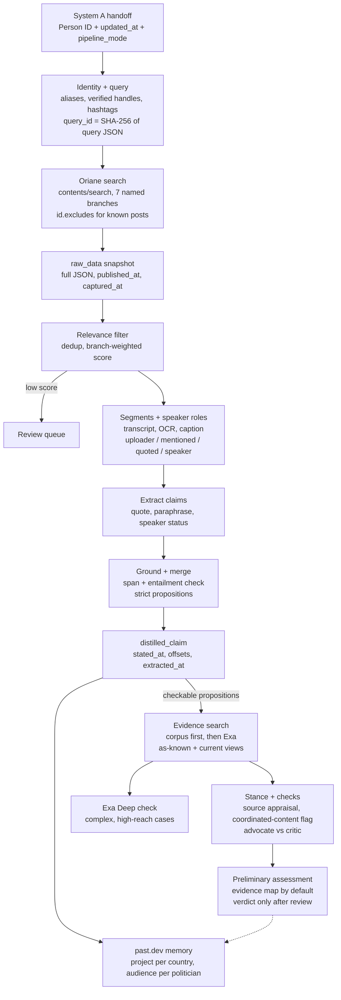

# Implementation brief for Devin (read first)

This file is the complete design for **System B**, the Politician Social Claims Pipeline. Build it as specified in the design doc below. System A (the political knowledge graph) already exists and is out of scope; System B reads from it.

**Files that go with this doc**

- `oriane-integration-connect.yaml`: Oriane Integration Connect OpenAPI spec (content search, profile search, assets).
- `README_GRAPH.md`: System A knowledge-graph structure (node types, IDs, evidence statuses, eligibility).
- Appendix A of this file: Mexico corpus sources (official APIs, bulk data, scraping needs).

**Secrets (environment variables; never commit them; keep `.env` git-ignored, mode 600)**

| Variable | Service | Auth header |
| --- | --- | --- |
| `ORIANE_API_KEY` | Oriane, `https://connect.oriane.xyz` | `Authorization: Bearer <key>` |
| `EXA_API_KEY` | Exa, `https://api.exa.ai` | `x-api-key: <key>` |
| `PAST_DEV_API_KEY` | past.dev, `https://api.past.dev/api/v1` (Mexico project) | `Authorization: Bearer <key>` |

**Facts verified with live calls on 2026-11-14**

- Oriane: Bearer auth works. Billing is per row returned (2 credits `basic`, 3 `default`, 4 `full`); calls returning no rows are free. `limit` max 100; at most 500 filter values per request; query nesting max 2 levels; `id.excludes` is supported (use it to skip already-captured posts). No balance endpoint: compute spend from rows returned.
- Exa: `x-api-key` works; one `type: auto` search with highlights cost $0.007. Current account limit 10 QPS (can be raised on request).
- past.dev: key works; the project currently has only the default `project` audience.

**MVP scope**

- Mexico, Spanish. Start with Phase 0 and Phase 1 (see Milestones).
- Mexico is `research_only` in System A until its expanded democracy gate ships: all output stays internal.
- Export mode is evidence-only; no verdict labels leave the system.

**Do not**

- Publish anything externally, or contact any person.
- Scrape TikTok or Instagram directly; Oriane is the only social data source.
- Store Exa page-passage text long-term until an Exa agreement allows it: store URLs, titles and dates, and re-fetch passages from the source.
- Create politician identities: every politician comes from System A by `Person` ID.

**Blocking open questions** (see the end of the design doc): how System B reads System A's graph; when System A's expanded gate ships; written storage and display permissions from Oriane, Exa and past.dev. Build retention and storage as configurable until these are settled.

---

# System B: Politician Social Claims Pipeline — Design Doc

Nov 14, 2026 · Author: Mauricio Roman

## Overview

System B takes a `Person` from System A's political knowledge graph (for example `person:MX:claudia-sheinbaum-pardo`), with that person's verified offices, terms, party and aliases. It queries Oriane for TikTok and Instagram content about them, stores what the provider licences allow, and extracts atomic claims tied to exact source spans and timestamps. It then builds an evidence map for each checkable claim from our curated corpus and Exa. No claim is attributed to the politician without direct speaker evidence, and no public verdict is issued without human review; the MVP publishes evidence maps, not verdicts. System B also honors System A's country eligibility: for a country in `research_only` mode, as Mexico is until System A's expanded gate ships, all output stays internal.

**Goals**

- High recall within Oriane's coverage: find content by, about, and tagging the politician, including spoken-only mentions with no caption or hashtag.
- Audit-friendly capture: keep the complete Oriane response in immutable, access-controlled raw storage where the agreement permits, plus a normalized view and a payload hash; otherwise keep only permitted fields and source URLs.
- Correct attribution: separate who uploaded, who is mentioned, who is quoted and who actually speaks. A claim is linked to a politician as speaker only with direct evidence.
- Claims as the unit of analysis: each claim is an atomic proposition with its exact quote, source offsets, speaker status and timestamps.
- Evidence maps: for each checkable proposition, dated supporting, contradicting and contextual evidence with provenance and uncertainty. Internal preliminary assessments; public verdicts only after review.
- Reproducibility by snapshot: persist the exact request, response hashes, observed-at times, model and prompt versions, and evidence snapshot. A fresh API call against Oriane's or Exa's changing index is a new snapshot, not a re-run.

**Non-goals (v1)**

- Publishing verdicts without review. Low-confidence and high-stakes verdicts always pass through a human reviewer.
- Platforms other than TikTok and Instagram, though Oriane also indexes YouTube.
- Direct scraping of platforms. Oriane is the only data source.
- Accounts under 5,000 followers and content older than Oriane's 3-month window, which Oriane does not index.

**Scope.** This document specifies System B only. System A, the political knowledge graph (Earth → Continent → Country → GovernmentLevel → GovernmentBody → PoliticalOffice → Person and Term, each claim backed by Source nodes), is an upstream dependency with its own specification. System A supplies verified identities and offices; it does not certify that a person in a video is the politician. Neither system contacts people.

**Publication policy (v1).** Automatically generated assessments stay internal until reviewed. Evidence maps may be shown when their provenance, uncertainty and licence compliance are visible. A designated reviewer approves any public verdict about an identifiable politician, and appeals and corrections are logged.

**Country eligibility gate.** System A marks each country `production` or `research_only` after its democracy and contact gates, and every System B record carries its country's `pipeline_mode`. Output for a `production` country can be shown externally, subject to the publication policy above; output for a `research_only` country stays internal (research and evaluation only). System A is expanding its democracy gate so that partially democratic countries, Mexico among them, pass and become visible. Until that change ships, Mexico is still `research_only` in the graph (`run-MX-20261114T230338Z`), so the pilot runs internally. When a country's `pipeline_mode` changes, a reconciliation job updates the flag on its existing records; nothing is published retroactively without passing review.

## Inputs and outputs

A job takes a System A `Person` ID, not free text. A user-supplied name is only a search alias: if it does not resolve to exactly one `Person` through `name` or `aliases`, the job stops for review. The job emits timestamped raw snapshots, posts, segments, claims and evidence maps.

| Field | Type | Required | From System A |
| --- | --- | --- | --- |
| `politician_id` | string | yes | `Person.id`, e.g. `person:MX:claudia-sheinbaum-pardo` |
| `country_code` | ISO 3166-1 alpha-2 | yes | `Country.iso2` (`country:MX` → `MX`) |
| `person_updated_at` | timestamp | yes | `Person.updated_at`: the identity version this run used |
| `graph_run` | string | yes | `pipeline_run` of the graph build read, e.g. `run-MX-20261114T230338Z` |
| `pipeline_mode` | enum | yes | `production` or `research_only`, from the person's country |
| `politician_name` | string | no | Search alias only, e.g. "Clara Brugada" |
| `date_from`, `date_to` | date | no | Default: Oriane's full 3-month window |
| `platforms` | list | no | Default `[tiktok, instagram]` |
| `max_posts` | int | no | Per-politician row cap (default 1,000) |

**Outputs**

- `run` — one record per job: tuple, resolved entity profile, the exact Oriane queries sent, counts, cost.
- `raw_data` — every Oriane payload as returned, with `published_at` and `captured_at`.
- `post` — one per video/post, with normalized fields and a pointer to its latest raw payload.
- `segment` — transcript, caption, on-screen text and comment spans, time-coded.
- `distilled_claim` — one per claim, pointing to its post and segment(s), with `stated_at`, video offsets and `extracted_at`.
- `evidence` and `claim_verdict` — the Exa sources found for each claim cluster and the resulting verdict, with `retrieved_at` and `validated_at`. Claims and verdicts are also written to past.dev memory: one project per country, one audience per politician, each stamped with its time.

**Where things live.** System A's graph is authoritative for politicians, offices and terms; System B links to it by `politician_id`. Postgres is System B's source of truth for job state, claims, evidence and review decisions. Object storage holds only licensed raw JSON and media excerpts. past.dev is a rebuildable recall layer, never an authority. Exports are JSONL or CSV per run.

**System A → B handoff contract.** System A has no event stream; its writes are upserts keyed on canonical IDs. So at the start of each run, System B reads one identity snapshot per person from the graph and stores it in `politician_ref`:

| System B needs | System A source |
| --- | --- |
| Canonical ID, name, aliases | `Person.id`, `name` (longest verified form), `aliases` |
| Identity version | `Person.updated_at`, `last_verified`, and the build's `pipeline_run` |
| Offices held, with dates | `HOLDS_OFFICE` edges (`current`, `status`, `start`, `end`, `is_acting`) and `Term` nodes; `PoliticalOffice` `name`, `title_local`, `keywords` |
| Jurisdiction | the office's `GovernmentBody` → `GovernmentLevel` (tier, `iso_3166_2`) |
| Party and coalition | `MEMBER_OF_PARTY` → `PoliticalParty` (`acronym`, `aliases`, `coalition`, `as_of`) |
| Evidence strength | `evidence_status` and `confidence` on `HOLDS_OFFICE` and `Term` |
| Country eligibility | `Country.eligible`, `pipeline_mode`, `research_status` |
| Social handles | **Not in System A.** Kept by System B (see Handle discovery) |

**Who is eligible to be tracked.** Only persons whose current `HOLDS_OFFICE` edge has `evidence_status` `verified` or `official_single`. `single_source` persons go to review first; `unsupported` claims are never stored in System A, so they never reach System B.

**Reconciliation.** System B compares each run's snapshot with the last one. A changed name, alias, office, term or party creates a new `politician_ref` version and a reconciliation job; historical claims are never silently relabeled. If System A merges two `Person` nodes (name variants are merged into one ID), System B records an ID redirect and relinks the old ID's records.

**Coverage that System B inherits from System A (Mexico build `run-MX-20261114T230338Z`):**

- 63 current officeholders: federal offices, the 32 states including Mexico City, its 16 boroughs, and 10 of Mexico's roughly 2,470 municipalities. Mayors outside those 10 cannot be tracked yet.
- Officeholders only. `CONTESTS_OFFICE` (candidates) exists but is not researched, and party posts are not `PoliticalOffice`s, so party leaders and would-be candidates (for example, several of the Morena figures in LatamPoliticalMonitor) are not in the graph.
- Tracking a person outside the graph requires System A to add them first; System B never creates politician identities.

## Architecture

The top row takes a versioned politician ID from System A, builds the stored query, and captures timestamped Oriane snapshots. The second row filters for relevance, assembles segments with speaker roles, extracts claims and merges only equivalent propositions. The bottom rows build evidence maps from the corpus and Exa, and write claims and assessments to past.dev memory. Low-relevance posts, uncertain speakers and uncertain assessments go to human review. Each worker is idempotent for a stored input snapshot; refreshing Oriane or Exa is a new, versioned run.

## Entity resolution and search strategy

The search starts from System A's identity snapshot, expands it into one composite Oriane query per politician, and filters the results for relevance. Query expansion raises recall, but a match never establishes that a post is by the politician, or that a quotation was spoken by them.

**Step 1 — Read the identity snapshot from System A**, then add what System A does not hold (social handles, ASR misspellings, hashtags). The snapshot provides:

- From System A: `name`, `aliases`, current and past offices from `HOLDS_OFFICE` and `Term` (with `start`, `end`, `is_acting`), office titles and `keywords`, jurisdiction from the office's government level, and party with coalition from `MEMBER_OF_PARTY`.
- Added by System B: ASR misspellings and accent-stripped variants of the name (Oriane's transcripts are weak on proper nouns), the surname alone only when distinctive, office-title phrases from `title_local` ("la jefa de Gobierno"), hashtags, and verified handles with their Oriane `profileId`s from `politician_account`.
- Associated entities (party, coalition, flagship policies, rivals), used for relevance scoring, not as standalone queries.
- The country's languages.

The composite query is stored as JSON, and its SHA-256 is the `query_id` used for every run for that person until the snapshot or the added terms change. Each claim also records `office_at_statement`: the office and term the person held on `stated_at`, taken from System A's `Term` dates.

**Step 2 — One composite query to `POST /rest/contents/search`.** The Oriane Integration Connect API (`https://connect.oriane.xyz`) accepts a nested query tree: `operator` (`and`/`or`), `filters`, and up to two levels of named sub-`queries`. Each sub-query carries a `name`, and Oriane returns it in every hit's `matchedQueries`, so one call tells us *why* each post matched. The tree's top level is an `and` of shared constraints (`platform`, `publishedAt`) with an `or` of these named branches:

| Branch `name` | API filter | Why |
| --- | --- | --- |
| `own` | `profileHandle.exactMatch` = official handles | Everything the politician posts |
| `coauthored` | `coAuthorHandles.exactMatch` = official handles | Collabs posted from another account |
| `tagged` | `mentionHandles.exactMatch` = official handles | Others @-mentioning them |
| `spoken` | `transcript.includesExactly`, operator `or`, name variants | Says the name, never writes it |
| `written` | `caption.includesExactly`, operator `or`, name variants | Captions and descriptions |
| `onscreen` | `onScreenText.includesExactly`, name variants | Name in overlays, banners, chyrons |
| `hashtag` | `hashtags` = profile tags | Campaign and fan content |

Visual search is out of scope for v1. Oriane's `POST /rest/assets` can store a face photo or text description as a reusable `assetId` for the `visualSimilarity` filter (2 credits per asset), but it only matches what is on screen, and Oriane notes it is unreliable for less prominent people. It can be added later as an eighth branch.

Use `includesExactly` for multi-word names; `includesFuzzy` matches the words anywhere, so "Tom" and "Ford" in unrelated places would hit. A request may hold at most 500 filter values across all levels, so long variant lists are split across runs. Optional narrowing filters: `transcriptLanguage` / `captionLanguage` (the country's languages) and `locationCountryCode`. Location is often inferred, so country filters go in scoring, not in the query.

Paging: `limit` max 100, `offset`, `sort=publishedAt:desc`, `projection=full`. Handle `206` (partial), `402` (credits exhausted, stop the run), `416` (offset past the end) and `400` (bad filter).

**Step 3 — Post-to-person relevance.** Deduplicate on platform-qualified IDs (Oriane content `id`, fallback `platform` + `platformId`) and keep every matched branch. `own` is strong evidence of authorship only when the handle was verified; `tagged` is evidence of mention, not authorship; transcript-only matches stay low confidence. Score relevance from the branches, full-name versus surname hits, language, `locationCountryCode` with its confidence, and associated entities. Marginal posts go to review, and both precision and missed relevant posts are measured.

**Handle discovery.** System A stores no social accounts, so System B owns them in `politician_account`. `POST /rest/profiles/search` generates candidates; official status is verified against the politician's website, an institutional directory or another independent source, because a verified badge, bio or follower count alone is not enough. Each account records the `politician_id`, platform, handle, Oriane `profileId`, supporting sources and first and last verified dates. Adding an account needs human approval. Proposed extension: System A adds a `SocialAccount` node so that both systems share one verified list.

**Lessons from LatamPoliticalMonitor** (our earlier Oriane project on Morena politicians):

- Once a handle is confirmed, store its Oriane `profileId` and filter the `own` branch on `profileId.includes`. Handles change; profile IDs do not.
- Many politicians have no indexed account and appear only through mentions. Record that per entity, so an empty `own` branch is not mistaken for a broken query.
- Cap paging per politician (that project used 1,000 rows, sorted by `viewsCount:desc`) so one heavily discussed name cannot exhaust the credit budget.

**Coverage disclosure** on every dashboard and export: the data covers only Oriane-indexed content, within the last 3 months, with up to a week of indexing lag, from creators with 5,000+ followers, and with platform and language limits. "No match" means no match in the indexed sample, not that the politician said nothing or that no evidence exists.

## Oriane capture

Searches use `projection=full` where extraction needs it and the licence permits. Each response is saved as an immutable `raw_data` snapshot (request, response, hash, `captured_at`) in restricted storage under a retention schedule, plus a normalized row with the minimum necessary fields. Any fields excluded for licence or privacy reasons are recorded in the run's processing manifest.

| Group | `full` projection fields | Used for |
| --- | --- | --- |
| Identity | `id`, `platform`, `platformId`, `platformType`, `format`, `title`, `publishedAt`, `createdAt`, `updatedAt`, `matchedQueries` | Keys, dedup, match provenance |
| Text | `caption`, `captionLanguage`, `hashtags`, `mentions`, `coAuthors` | Caption claims, tagging |
| Media | `media[]`: `type`, `duration`, `caption`, `transcript`, `transcriptLanguage`, `transcriptChunks[]` (`startSeconds`, `endSeconds`, `text`), `onScreenText`, `tags`, `frames[]` (`timestampSeconds`, `onScreenTextRegions`, `url`, `visualSimilarityScore`) | Spoken and on-screen claims, timestamps, evidence frames |
| Engagement | `viewsCount`, `likesCount`, `sharesCount`, `commentsCount`, `interactionsCount`, `engagementRatePerViews`, `engagementRatePerFollowers`, `viewsRatePerFollowers` | Reach weighting of claims |
| Creator | `profileId`, `profileHandle`, `profileDisplayName`, `profileBio`, `profileVerified`, `profileFollowersCount`, `profileFollowingCount`, `profilePostsCount`, `profilePictureUrl`, `profileEmails`, `profileLocation*` | Speaker attribution, source type |
| Location | `location*` (city, province, country, code, coordinates), each with `*Source` and `*Confidence` | Country relevance |
| Audio | `audioPlatformId`, `audioTitle`, `audioAuthor`, `audioType`, `audioCopyrighted` | Detect reused audio (a speech clip shared by many posts) |
| Comments | `popularComments[]` (`content`, `profileHandle`, `likesCount`, `repliesCount`, `publishedAt`) | Audience reaction only (not a claim source in v1) |
| Thumbnail | `thumbnailMediaId`, `thumbnailMediaUrl`, `mediaCount` | Review UI |

The response `aggregations` (total and average views, likes, interactions, engagement rates) and `metadata` (`requestId`, `executionTime`, pagination) are stored on the `run` record.

**Re-polling.** Engagement keeps changing after capture. A job re-fetches each post at days 1, 3, 7 and 14 by `id` filter with the `basic` projection and appends an engagement snapshot rather than overwriting. Frame and thumbnail URLs may expire, so evidence frames cited by a claim are copied into our object storage when the claim is created.

**Profiles.** Distinct `profileId`s are enriched once per run via `POST /rest/profiles/search` (`projection=full`) and cached, which gives creator classification its inputs: official, party, media outlet, influencer, or anonymous.

## Content processing

We rely on Oriane's transcripts and OCR instead of downloading video. Each post becomes an ordered list of time-coded **segments**, one per text source, which is what the claim extractor reads.

| Segment source | From | Time code |
| --- | --- | --- |
| `speech` | `media[].transcriptChunks[]` | `startSeconds`–`endSeconds` |
| `onscreen` | `frames[].onScreenTextRegions[]`, merged across consecutive frames with the same text | `timestampSeconds` of first and last frame |
| `caption` | `caption` + `hashtags` (+ `media[].caption` for carousels) | none |
| `comment` | `popularComments[].content` | `publishedAt` |

Steps per post:

1. **Language and translation.** Keep the original text. Add an English translation per segment when the transcript or caption language is not English.
2. **Proper-noun repair.** Replace known ASR misspellings of the politician and associated entities with canonical forms, keeping the original span.
3. **Speaker attribution.** Oriane provides no diarization. Each post records separate roles: `uploader_account`, `account_owner`, `mentioned_person`, `quoted_person` and `actual_speaker`. A politician is assigned as speaker only with directly traceable evidence, such as a verified own account showing them speaking, or an authoritative transcript of the same event. A transcript mention, a handle or an on-screen name banner alone is not enough. Otherwise the speaker is `unknown`, and ambiguous or high-impact cases go to review.
4. **Reused audio.** Posts sharing an `audioPlatformId` that is a speech clip are grouped, so a statement re-posted many times is extracted once and linked to every post.
5. **Gaps.** Posts with no transcript and no on-screen text get caption-only extraction, flagged as low-information.

**Audience reaction from comments.** Comments are a reaction signal only. Oriane returns at most 15 popular (most-liked) comments per post: a selected, non-representative sample. Each comment is labeled for stance toward the politician (for, against, neutral) and as human, likely bot, or unsure. A comment counts as a likely bot only when the same generic text appears on 3 or more posts; a handle pattern alone is not enough. Reaction score = (for − against) ÷ human comments, from −100 to +100, shown with a selection-bias warning and never presented as public opinion. Only minimal comment metadata is stored.

**Fallback (v2).** If Oriane transcripts prove too weak for a country's language, download the media for posts above a reach threshold and run our own ASR and diarization.

## Claim distillation

Each post becomes zero or more claims. A claim is one checkable or attributable statement, rewritten to stand alone, tied to the exact span and timestamp it came from. Claims come from speech, on-screen and caption segments only; comment segments feed audience-reaction metrics and are never sent to extraction.

**Definition.** A claim is a specific proposition explicitly expressed in speech, a caption or visible text. Greetings, calls to action, jokes with no proposition and song lyrics are not claims. A clip discussing a politician does not mean the politician made the claim: who asserted it is recorded separately, through the speaker roles above.

**Extraction (LLM, Claude, structured output):** one call per post with all its segments, the entity profile, and post metadata. For each claim the model returns:

- `quote` — the exact original-language span, with `segment_ids` and start/end offsets.
- `text` — a normalized paraphrase that resolves pronouns and relative dates (from `published_at`) but never strengthens the claim or adds facts.
- `speaker_id` and `speaker_status` (verified, probable, unknown), filled only after attribution, with `speaker_evidence_ids`.
- `relation_to_politician` — speaker, subject, quoted, or mentioned; and whether the speaker asserts the claim or only quotes it.
- `type` — factual, statistic, policy position, commitment, forecast, accusation, opinion.
- `topics` — from the country's fixed taxonomy.
- `entities` — people, organizations, places, numbers with units, and the referenced place and period.
- `checkworthiness` — 0–1: specific, verifiable, and of public interest.
- `modality` — asserted, questioned, quoted, satire.

**Grounding check.** First verify that the `quote` aligns exactly with the source span and timestamp. Then a semantic check confirms the paraphrase is entailed by the quote, with no changed numbers, dates, scope or negation. Fuzzy string similarity (≥ 0.9) only helps find the span; it is not proof of faithful meaning or of who spoke. Uncertain results are flagged for review, not silently deleted.

**Proposition-level clustering.** Claims merge into one `proposition` only when subject, predicate, negation, numbers and units, place, reference period and qualifiers all match. Each speaker and source instance stays a separate assertion linked to that proposition. Claims that are merely related (same topic, different figures or dates) share a topic node, never a proposition or an assessment. Precision on hard near-duplicates is reviewed by humans. Propositions are what get validated.

**Versioning.** Every claim records `extractor_version` (prompt hash + model ID). Re-running a new version writes new rows; old ones are kept for comparison.

## Claim validation with Exa

Each checkable proposition gets an evidence map (supporting, contradicting, contextual and missing evidence) and an internal preliminary assessment, from our curated source corpus first and then the [Exa Search API](https://docs.exa.ai/docs/reference/search). Sources that merely repeat the original social clip are kept apart from independent corroboration. A proposition repeated in 400 videos is checked once.

**What gets validated.** Empirically testable factual and statistical propositions, and factually testable accusations, with `checkworthiness` ≥ 0.5. Priority comes from public interest and potential for harm, then reach. Commitments are checked once their deadline passes. Opinions and forecasts that cannot yet be observed are "not currently verifiable", never "false".

**Curated evidence corpus first, Exa second.** For each country in scope we maintain our own searchable `corpus_document` index, ingested on a schedule from vetted sources: official statistics releases, government and ministry press releases, parliamentary records (speeches, bills, votes), court decisions, the archives of IFCN fact-checkers in that country, and a licensed news wire for priority countries. Every query in Step 1 runs against the corpus first (hybrid keyword + embedding search, filtered by publication date). Exa is also called when corpus evidence is stale, one-sided or incomplete, or when the claim is high impact, even if the corpus has hits. Skipped searches are logged with the reason. This puts trusted sources first, makes the evidence harder to manipulate, and leaves more of the 10 QPS Exa budget for gaps.

**Step 1 — Query planning (LLM).** From the canonical claim, its entities, `referenced_period`, and the country, generate 3–5 natural-language queries (one per row below; the fact-check and primary-source rows are dropped when no domains are listed for the country). Exa works best with queries that state the subject, source type, and period.

| Query | Example for "unemployment fell to 2.5% in September" | Exa parameters |
| --- | --- | --- |
| Neutral restatement | "Mexico unemployment rate September 2026" | `type: auto`, `category: news` |
| Primary source | "INEGI official unemployment figures September 2026" | `includeDomains` = country's official statistics, government, legislature, court domains |
| Fact-check | "fact check Sheinbaum unemployment claim" | `includeDomains` = IFCN fact-checker allowlist for the country |
| Counter-evidence | "Mexico unemployment rose September 2026" | `type: auto` |
| Local language | Same as neutral, in the country's language | `userLocation` = country code |

Shared parameters: `numResults: 10`, `contents.highlights: true`, `objective` set to "find evidence that supports or refutes this claim", `excludeDomains` = tiktok.com, instagram.com plus the country block list, so the social posts cannot validate themselves and known manipulation sources never enter. Fact-check and primary-source queries use the country allow list as includeDomains.

**Step 2 — Two time views.** Every proposition is checked twice:

- *As known when stated*: sources published before `stated_at`, read as they stood then. A publish-date filter alone cannot show what a page said on an earlier date, so page text is fetched as an archived snapshot (Exa's `contents.snapshotAsOf`, or the corpus version stored at ingestion). A view rebuilt without archived snapshots is marked provisional.
- *Current*: up-to-date evidence, with publication and revision dates.

The two verdicts can differ (a figure true when said and later revised), and both are stored.

**Step 3 — Evidence consolidation.** Results across queries are deduplicated by URL, then by highlight similarity, so 12 outlets running one wire story count as one independent source. For the top 5 results, `POST /contents` fetches page text with `highlights.query` = the claim, so each evidence passage is quoted from the page.

**Coordinated-content check.** Web results can be seeded to steer search engines and AI answers (Generative Engine Optimization). Each country has an allow list and a block list, maintained by qualified reviewers through a documented, contestable process. Near-identical text from 3 or more low-tier or unknown domains within 7 days of `stated_at`, or a domain under 90 days old, raises a `suspected_seeding` flag. Flagged evidence is grouped as one source, sent to review, and cannot support or contradict a proposition on its own until a reviewer clears it. It is a signal to investigate, not proof the content is false.

**Step 4 — Source appraisal.** Each piece of evidence is appraised at document and claim level, not by domain tier alone. Official sources are primary for their own statements, laws and records, but a ministry is not independent proof of its own performance. Firsthand measurements, interested-party assertions, journalism and repeated citations are kept distinct. The starting weight uses System A's `authority_tier` scale (1 official, 2 reference or press, 3 other), and evidence URLs use System A's `Source` ID scheme (a hash of the canonical URL), so a page both systems cite is the same source.

**Step 5 — Stance per evidence (LLM).** For each passage: supports, refutes, adds missing context, or irrelevant, with the exact supporting sentence. The same grounding rule as extraction applies: a stance whose quoted sentence is not in the fetched page is discarded.

**Step 6 — Preliminary assessment.** Documented rules over independence, direct relevance, date and scope produce an internal label; an LLM writes a 2–3 sentence rationale citing evidence IDs. These labels are internal until a reviewer approves publication.

| Internal label | Rule |
| --- | --- |
| `supported` | Direct, temporally relevant, independent evidence supports the full proposition; contradictions and caveats recorded |
| `misleading` | Only after a reviewer judges that omitted context changes the reasonable reading; the missing context and alternative readings are recorded |
| `contradicted` | Direct, independently corroborated, temporally relevant evidence contradicts it. A self-interested official denial is not conclusive |
| `disputed` | Credible independent sources on both sides |
| `insufficient_evidence` | Not enough evidence now; search scope and revisit date recorded. Absence of evidence never means false |
| `not_currently_verifiable` | Opinion, or a forecast or commitment not yet due |

Each assessment carries a confidence from 0 to 1. Confidence under 0.7, every `contradicted` or `misleading` label about the politician as speaker, and every claim with uncertain attribution go to review before any export.

**Advocate–critic panel.** Before a verdict is final, two agents read the same retrieved evidence. The advocate builds the strongest case that the claim holds; the critic builds the strongest case that it fails or misleads. Each may cite only evidence IDs already retrieved, and each case goes through the grounding check. The verdict rules above still decide; the panel does not vote. Its role is to catch a one-sided read: if the losing side's case cites at least one tier-1 or tier-2 passage the rules did not weigh, the claim goes to review with both cases attached. Both cases are stored with the verdict and shown in the rationale, so readers see the counter-argument.

**Re-validation.** `unverifiable` verdicts are re-run after 7 and 30 days, since news coverage often lags social media. Every run appends a new verdict row, so the verdict history is kept.

**Exa Deep as a second opinion.** For selected complex, high-reach propositions, run `type: deep` with an `outputSchema` asking for an assessment and citations, after checking endpoint support and billing on our plan. Disagreement with our rule-based label is a review flag, not ground truth.

**Publication modes.** The MVP default is evidence-only. Approved-verdict mode is a separate launch decision.

- *Evidence-only (default)*: the original claim, speaker status, sources for and against with credibility and dates, context, uncertainties and both panel cases. No label.
- *Approved verdict (later)*: adds the label and rationale, only after reviewer approval, with published methodology, correction and version history, and the same rules for every party.

Verdicts are always computed internally for review and evaluation, even in evidence-only mode. We publish a methodology page and a neutrality policy covering: the same rules and thresholds apply to every politician and party; how credibility tiers are assigned and appealed; how the panel works; and how corrections are issued.

## Claim memory in past.dev

Every grounded claim with its source, and every assessment event, is also written to [past.dev](https://past.dev), a timestamped memory API: one past.dev project per country, one audience per politician. past.dev holds licensed, non-sensitive summaries with pointers to the Postgres claim and assessment IDs. It is rebuildable from Postgres, and what it returns is context for agents and analysts, never evidence by itself.

**Layout: one project per country, one audience per politician**

past.dev has no files. Its unit of isolation is the project: memory, API key, monthly caps and usage line are separate per project, and nothing crosses between projects ([access control](https://past.dev/docs/memory-api/access-control)). So each country is a project, and each politician is an audience inside it.

| Level | past.dev object | Naming | Example |
| --- | --- | --- | --- |
| Country ("file") | Project, with its own key | `claims-<country>` | `claims-mx`, key in `PAST_DEV_API_KEY` |
| Politician (split) | Audience, rule-based | `pol-<entity_slug>` | `pol-clara-brugada` |
| Claim + source | Data point | `claim-<claim_id>`, `timestamp` = `stated_at` | `claim-7f3a…`, 2026-11-03T14:05:00Z |
| Verdict | Data point | `assessment-<assessment_id>`, `timestamp` = `validated_at` | `verdict-91c2…` |

A claim involving two politicians (a debate clip) stays one claim in Postgres, linked to both through `claim_person_role` (speaker, subject, quoted, mentioned). Each politician's audience gets its own data point, `claim-<claim_id>-<politician_id>`, pointing to the same canonical claim. These copies never count as extra claims or independent evidence.

**What each data point holds.** The `label` is `<platform> post by @<handle> about <politician>`. The `content` is plain text that past.dev can read:

- the canonical claim (`text`) and its English translation;
- the verbatim `quote` with `quote_start_s`–`quote_end_s`;
- speaker, claim type, topics, stance toward the politician;
- the source: platform, post URL, Oriane content id, creator handle, `published_at`, views at capture;
- `extracted_at` and `extractor_version`.

An assessment data point holds the claim and proposition ids, time view (as known or current), internal label, review status, confidence, rationale, and evidence URLs with their publication dates. Exa passages are not copied (see Terms review); only URLs, titles and dates go in.

Keeping verdicts as separate data points, each stamped with `validated_at`, means a recall with `queryTimestamp` returns what we knew on that date: the claim, and the verdict that applied then.

**Writing.** After the grounding check, a writer sends new claims with `POST /api/v1/ingest/batch` (up to 1,000 data points and 16 MiB per call), using `run_id` plus the batch number as `idempotencyKey`. Data point IDs are immutable and versioned: a correction or a new assessment is a new data point (`claim-<id>-v2`, `assessment-<id>`), never an overwrite under the same ID, so reading memory as of a past date stays reliable. An integration test confirms `queryTimestamp` behaves this way before launch. Postgres event history remains the authoritative timeline. The writer polls `GET /api/v1/ingest/{ingestionId}` until `completed` and records every ID it sent, because past.dev has no route that lists them.

**Reading.** `POST /api/v1/recall` with a question and an identity returns ranked memories with their dates and source excerpts. `occurredFrom` / `occurredTo` limit it to a period, and `queryTimestamp` reads memory as it stood on a past date. Uses:

- *Extraction*: before clustering, check whether a politician already made the same claim, and when.
- *Validation*: surface the politician's earlier claims on the same topic as context for the advocate–critic panel.
- *Analysts*: questions like "what has Clara Brugada claimed about water supply since August?", answered with dated sources.

**Identities.** Readers are identities with traits. Each politician audience is a rule that matches identities whose `politician` trait is that politician or whose `scope` trait is `country`. Service workers recall as one politician; country analysts get `scope = country` and read every politician in that project. Analysts in another country hold a different project's key and cannot read it.

**Deletion.** Deleting a data point removes it and every memory resting only on it. Deletion requests (for example by `profile_id` under data-protection law) are applied in Postgres and then in past.dev, using the recorded ids.

**Cost and limits.** Ingest costs one credit per 350 bytes of content, minimum one per data point; unchanged re-sends cost nothing. A claim data point of about 1 KB costs 3 credits. Recall costs 1 credit on Pay as you go and nothing within fair use on Flex. Requests are capped at 500 per minute on Pay as you go, 750 on Flex. A batch of up to 1,000 claims counts as one request, so the cap matters for recall, not ingest. Pay as you go starts with 150,000 credits for $45 (about $0.0003 a credit), so storing one claim costs about $0.001 ([pricing](https://past.dev/pricing)).

## Data model

Fifteen core tables in Postgres (with pgvector for embeddings); raw Oriane JSON lives in licensed object storage, referenced by path. Politicians and offices are not owned here: `politician_ref` mirrors the System A version each run used.

| Table | Key | Main columns | Timestamps (all UTC, required) |
| --- | --- | --- | --- |
| `politician_ref` | `politician_id`, `person_updated_at` | `graph_``run, country_code, pipeline_mode, name, aliases, offices and terms, party, evidence_statu`s, `query_json`, `query_id` (SHA-256) | `received_at`, `superseded_at` |
| `run` | `run_id` | `politician_id`, `person_updated_at, graph_run, pipeline_mode`, `query_id`, `date_from`, `date_to`, `platforms`, `request_ids[]`, `aggregations`, `rows_returned`, `credits_used`, `status` | `started_at`, `finished_at` |
| `raw_data` | `raw_id` | `run_id`, `oriane_id`, `platform`, `projection`, `request_id`, `payload_path`, `payload_sha256`, `excluded_fields` | `published_at`, `oriane_created_at`, `oriane_updated_at`, `captured_at` |
| `post` | `oriane_id` | `platform`, `platform_id`, `profile_id`, `caption`, `languages`, `location_country_code`, `matched_queries[]`, `relevance_score`, `latest_raw_id` | `published_at`, `first_observed_at`, `last_captured_at` |
| `post_metrics` | `oriane_id`, `captured_at` | `views`, `likes`, `shares`, `comments`, `interactions`, engagement rates, `post_age_days` | `captured_at` |
| `segment` | `segment_id` | `oriane_id`, `raw_id`, `source`, `start_s`, `end_s`, `text`, `text_en`, `language` | `published_at` (inherited), `created_at` |
| `post_person_role` | `oriane_id`, `person_id`, `role` | `role` (uploader, account\_owner, mentioned, quoted, speaker), `status`, `evidence_ids[]`, `segment_ids[]` | `assigned_at`, `reviewed_at` |
| `distilled_claim` | `claim_id` | `oriane_id`, `raw_id`, `segment_ids[]`, `proposition_id`, `text`, `text_en`, `quote`, `speaker_id`, `speaker_status`, `speaker_evidence_ids[]`, `type`, `topics[]`, `checkworthiness`, `modality`, `embedding`, `extractor_version`, `grounding_status` | `stated_at`, `original_utterance_at` (only when evidenced), `quote_start_s`, `quote_end_s`, `referenced_period`, `extracted_at` |
| `claim_person_role` | `claim_id`, `person_id`, `role` | `role` (speaker, subject, quoted, mentioned), `asserts_or_quotes`, `evidence_ids[]` | `assigned_at` |
| `proposition` | `proposition_id` | canonical text, subject, predicate, negation, values and units, place, period, qualifiers, `topic_id` | `created_at`, `first_stated_at` |
| `corpus_document` | `doc_id` | `country`, `source_id`, `url`, `doc_type`, `title`, `language`, `text_path`, `version_hash`, chunks + embeddings, `credibility_tier` | `source_published_at`, `source_updated_at`, `ingested_at` |
| `source_list` | `country`, `domain` | `list` (allow / block), `credibility_tier`, `licence`, `reason`, `added_by` | `added_at`, `reviewed_at` |
| `validation_run` | `validation_id` | `proposition_id`, `time_view`, `queries_json`, `searches_skipped` (with reasons), `corpus_hits`, `exa_request_ids[]`, `exa_cost_usd`, `validator_version` | `started_at`, `finished_at`, `evidence_cutoff` |
| `evidence` | `evidence_id` | `validation_id`, `origin` (corpus / exa), `doc_id` or `url`, `domain`, `title`, `author`, `source_type` (firsthand, interested party, journalism, citation), `credibility_tier`, `passage` or `passage_ref`, `snapshot_ref`, `stance`, `stance_conf`, `independence_group`, `suspected_seeding` | `source_published_at`, `snapshot_as_of`, `retrieved_at` |
| `preliminary_assessment` | `assessment_id` | `proposition_id`, `validation_id`, `time_view`, `label`, `confidence`, `rationale`, `evidence_ids[]`, `advocate_case`, `critic_case`, `panel_flag`, `review_status`, `reviewer_id`, `publication_approval`, `corrections_log` | `assessed_at`, `reviewed_at`, `published_at`, `next_check_at` |

Supporting tables: `politician_account` (verified social handles and Oriane `profileId`s per `politician_id`, with sources and verified dates; System A has no such data), `person_id_redirect` (old → new `Person` ID when System A merges nodes), `profile` (cached Oriane profiles and our creator class), `topic` (related propositions, counts, reach), `review` (human labels and decisions on posts, roles, claims and assessments). Every record also carries `pipeline_mode`, and claims carry `office_at_statement`.

`memory_record` tracks what was sent to past.dev, since past.dev cannot list it back: `datapoint_id` (key), `kind` (claim / verdict), `claim_id` or `verdict_id`, `entity_id`, `past_project` (`claims-<country>`), `audience` (`pol-<entity_slug>`), `ingestion_id`, `status`, `content_sha256`, and timestamps `memory_timestamp` (the `stated_at` or `validated_at` sent), `sent_at`, `completed_at`, `deleted_at`.

A post can belong to many runs and many politicians (a debate clip shows two candidates), via `run_post` plus `post_person_role` and `claim_person_role`. A person mentioned in a clip is never inferred to be its uploader or speaker; each asserted speaker relationship keeps its own evidence IDs.

**Timestamps are mandatory on both layers.** Every `raw_data` row carries the platform's publication time and the time we captured it; a re-fetch writes a new row, so each post's history is kept. A post's `published_at` is when it appeared online, which is not necessarily when the politician spoke (archival clips, reused audio). Every `distilled_claim` carries:

- `stated_at` — when the claim appeared publicly: the post's `published_at`.
- `original_utterance_at` — when it was actually said, filled only with independent evidence (for example, the date of the speech a clip comes from); otherwise null and marked unknown.
- `quote_start_s` / `quote_end_s` — where in the video it is said; null for captions.
- `referenced_period` — the date range the claim is about, if any, resolved against `stated_at`.
- `extracted_at` — when our pipeline produced it, with `extractor_version`.

Posts also carry `first_observed_at`, when our pipeline first saw them.

A claim or raw row missing its required timestamps fails validation and is not written.

## Evaluation and quality

The MVP is accepted on a Mexico/Spanish gold set; the multi-country set (10 politicians, 5+ countries, 4+ languages) gates global release. Retrieval, attribution, extraction and evidence are measured separately. A manual search in Oriane's UI estimates relative recall within Oriane, not recall across the whole platform.

| Stage | Metric | v1 target | How measured |
| --- | --- | --- | --- |
| Retrieval | Precision of kept posts | ≥ 0.90 | Label 100 random kept posts per politician |
| Retrieval | Relative recall within Oriane | Tracked | Posts a manual Oriane UI session finds that our query missed |
| Attribution | Wrong-speaker rate | ≤ 1%; every consequential case reviewed | Annotated posts where a politician is assigned as speaker |
| Attribution | Speaker accuracy | ≥ 0.85 | Same annotated posts |
| Extraction | Claim precision (valid, grounded) | ≥ 0.90 | Two annotators per claim |
| Extraction | Claim recall | ≥ 0.75 | Annotators list claims in 200 posts |
| Grounding | Unfaithful paraphrases (changed numbers, dates, scope, negation) | ≤ 2% | Manual check of quote vs. paraphrase |
| Clustering | False merges of distinct propositions | ≤ 2% | Hard negatives: same topic, different figures or dates |
| Clustering | Pairwise F1 | ≥ 0.80 | Annotated claim pairs |
| Evidence | Relevant evidence in top 5 | ≥ 0.80 of checkable propositions | Annotators judge corpus and Exa passages |
| Evidence | Independence errors | Tracked | Repeats of the original clip counted as corroboration |
| Evidence | Stance accuracy | ≥ 0.85 | Annotated passage–claim pairs |
| Evidence | Coordinated-content flags | ≥ 0.90 recall, ≤ 5% false flags | Red-team set of planted article clusters |
| Evidence | As-known view validity | Tracked | Archived examples where the page changed after `stated_at` |
| Assessment | Agreement with professional fact-checks | ≥ 0.80 macro-F1 | 300 Mexican claims already rated by IFCN fact-checkers |
| Assessment | Severe errors (supported ↔ contradicted) | ≤ 1% | Same set |
| Review | Reviewer agreement | Tracked (Cohen's κ) | Double review of 10% of cases |
| Review | Partisan symmetry | No significant gap | Label and review rates compared across parties on matched claim types |

Every prompt or model change reruns the gold set before release. In production, 1% of claims are sampled weekly into the `review` table to watch for drift.

## Operations

Runs are idempotent jobs on a queue (one job per tuple), so a failed run resumes from its last stored page instead of restarting.

- **Secrets.** `ORIANE_API_KEY`, EXA\_API\_KEY and PAST\_DEV\_API\_KEY for the Mexico past.dev project (each later country project gets its own key) are read from the environment (locally `.env`, mode 600, git-ignored; in deployment a secrets manager). Never logged; request logs keep only Oriane's and Exa's `requestId`.
- **Paging and limits.** 100 results per page. Pages are fetched sequentially per run, with a per-key concurrency cap across runs. Exponential backoff on `5xx`; a `402` stops all runs and alerts, since credits are exhausted.
- **Scheduling.** Each worker is idempotent for an immutable input snapshot; a provider refresh is a new run with new observation times. Initial backfill uses the full 3-month window. Tracked tuples then run daily over the last 10 days, which covers Oriane's indexing lag of up to a week. Engagement snapshots are taken at days 1, 3, 7 and 14 after publication (see Oriane budget).
- **Cost control.** Credits and LLM tokens are recorded per run. Extraction skips posts below the relevance threshold, and reused-audio grouping avoids re-extracting the same speech. Use a smaller model for grounding and speaker labeling, a larger one for extraction.
- **Observability.** Per run: posts found per branch (`matchedQueries`), dedup rate, review-queue size, claims per post, grounding-rejection rate. A sudden change in any of these flags a query or upstream problem.
- **Retention.** Raw payloads, excerpts and frames kept only for the duration and scope allowed by provider agreements, privacy law and documented research needs, with configurable deletion deadlines and audited exceptions; evidence frames kept only while a claim references them; Exa evidence stored as passages and URLs, not full article text.

**Exa throughput: currently 10 queries per second, account-wide.** That is today's limit, not a hard ceiling: Exa can raise it on request, and we should ask before backfills or launch. The design works within it and scales up when it is raised:

- **Shared limiter, per endpoint class.** A Redis token bucket for the whole account (set to the current limit, configurable), with sub-budgets for Search, Contents and Deep. On HTTP 429 or a `Retry-After` header, workers back off with jitter and the bucket lowers its rate, then recovers.
- **Planning numbers, not guarantees.** Up to 5 queries × 2 time views + 1 batched `/contents` call = 11 requests per proposition is a worst case: about 3,200 propositions an hour at 10 QPS. Corpus hits, caching and retries change the real figure, so dashboards use measured per-endpoint cost and latency.
- **Priority queue.** Propositions are ordered by public-interest priority, then reach. Re-validation runs at lower priority.
- **Fewer calls.** Exa responses are cached for 24 h, keyed on query + filters. The as-known view is skipped when `stated_at` is under 48 h old.
- **Deep searches** draw from their own sub-budget, capped at 10% of the bucket.
- **Backlog.** If the queue would miss its service level, alert and pause or de-prioritize by a documented policy, or request a higher limit. Never quietly raise the checkworthiness threshold: that changes coverage across politicians and breaks comparisons over time. Every sampling-policy change is logged.

**Corpus ingestion.** One ingestion job per source, scheduled by how often it publishes (statistics and press releases hourly, parliamentary records daily, fact-checker archives daily). Each job prefers official APIs or RSS feeds and stores the source's publication time plus our `ingested_at`. Source lists are reviewed quarterly per country. Because most queries are answered from the corpus, actual Exa use should fall well below the 11 requests per cluster budgeted above; corpus coverage is tracked per country.

**Oriane budget.** Per [Oriane's pricing](https://www.oriane.xyz/pricing), content and profile search are billed per row returned, at 2 credits per row on `basic`, 3 on `default`, 4 on `full`. A call that returns nothing is free. At yearly billing that is $1.79 (Plus) to $1.42 (Enterprise) per 1,000 basic rows, about $0.90 to $0.71 per 1,000 credits. There is no balance endpoint and no cost header, so spend is computed from rows returned and logged per run.

Measured on 2026-11-14 for one high-profile politician (Clara Brugada, Mexico City): 180 matching TikTok and Instagram posts in 30 days, 397 in 90 days.

| Item, per high-profile politician | Rows | Credits |
| --- | --- | --- |
| One-off backfill, 90 days, `full` | \~400 | \~1,600 |
| New posts per month, `full` | \~180 | \~720 |
| Engagement snapshots at days 1, 3, 7, 14, `basic` | \~720 | \~1,440 |
| **Monthly total** |  | **~~2,200 (~~$2)** |

The Plus plan (28,000 credits a month) covers about 12 politicians at this level; Pro (320,000) about 145. Lower-profile politicians cost much less.

Two rules keep spend there:

- Daily discovery runs pass the IDs already captured in the window as `id.excludes`, so overlapping days are not billed twice. Only new rows are returned and paid for.
- Engagement is re-polled at 4 points, not daily for 14 days (which would cost about 3.5× more), using `basic` and an `id.includes` filter.

This estimate is for one high-profile politician; volumes vary by politician, language and campaign period. Oriane credits are tracked per run against a hard monthly ceiling, and jobs stop gracefully when it is reached.

## Risks, privacy and compliance

The biggest risk is misattribution: putting words in a politician's mouth that a creator said. The design addresses it with explicit speaker labels, the grounding check, and keeping every claim linked to its verbatim quote and timestamp.

| Risk | Mitigation |
| --- | --- |
| Misattribution: a creator's words, or a quoted person's, assigned to the politician | Separate uploader, owner, mentioned, quoted and speaker roles; speaker only with direct evidence; `unknown` instead of guessing; wrong-speaker rate gated in evaluation |
| Hallucinated or unfaithful claims | Exact span alignment plus semantic entailment check; quote + timestamp on every claim |
| False merges (different figures or dates treated as one claim) | Proposition-level clustering on subject, numbers, place, period and negation; hard-negative evaluation |
| Wrong public verdict about a real politician | Evidence-only default; internal preliminary labels; reviewer approval, methodology, corrections and appeals before any verdict is published |
| Wrong person or identity drift | Canonical `politician_id` from System A; versioned identity snapshots; explicit reconciliation when offices or identities change |
| Coordinated content (Generative Engine Optimization) | Curated corpus first; contestable allow/block lists; `suspected_seeding` flags sent to review |
| Circular validation (articles that just repeat the viral video) | Exclude social domains; independence groups; repeats of the clip kept apart from corroboration |
| Weak or self-interested sources | Document- and claim-level appraisal; official sources not treated as independent proof of their own performance |
| Hindsight bias | Separate as-known and current views; archived snapshots for the as-known view, otherwise marked provisional |
| Thin evidence (regional media, countries without good feeds) | Corpus coverage tracked; local-language queries; `insufficient_evidence`, never `contradicted`, when evidence is missing |
| Coverage bias (3-month window, 5,000+ follower creators, ASR weak on names) | Coverage disclosure on every export; "no match" never presented as absence |
| Satire, parody, deepfakes | `modality` field; flag in review; no authenticity judgment in v1 |
| Personal data (commenters, small creators, `profileEmails`) | Minimize at ingestion; don't collect unneeded identifiers or contact fields; encrypt and restrict what is kept for an approved purpose |
| Provider and source terms | Written permissions for storage, display and retention before raw capture or public release (see Terms review) |
| Data protection (GDPR, Mexican law) | Legal basis assessed per country and deployment with counsel; no blanket research or journalism exemption; purpose, minimization, retention, access, erasure and transfer rules recorded |
| Bias in topics, roles and labels | Per-country taxonomies reviewed by native speakers; partisan-symmetry and reviewer-agreement metrics |

**Terms review (2026-11-14).** Neither provider's public terms clearly permit what the design needs: keeping raw payloads and evidence passages long-term and showing passages to customers. Written agreements are required before launch.

| Provider | What the public terms say | Implication | Action |
| --- | --- | --- | --- |
| [Oriane](https://oriane.xyz/terms-of-service) | No explicit clause on storing, caching or redistributing results. Prohibits attempts to "copy, or extract proprietary models or datasets". Oriane does not claim ownership of the indexed third-party content. Customers are responsible for how they use outputs. Delaware law; [DPA](https://oriane.xyz/dpa) available. | Long-term storage of `raw_data` could be read as copying Oriane's dataset. Rights in the videos themselves stay with creators and platforms. | Get written permission to retain raw payloads and derived claims indefinitely, and to show quotes and thumbnails to customers. Sign the DPA. |
| [Exa](https://exa.ai/assets/Exa_Labs_Terms_of_Service.pdf) | Prohibits copying, distributing, displaying, creating derivative works from, or offering for sale "any information contained on, or obtained from or through, the Services" unless expressly permitted in writing. Also prohibits using Output to build a competing product. Exa may use queries and Output to improve its products, including model training per its [privacy policy](https://exa.ai/privacy-policy); zero data retention and [EU residency](https://exa.ai/blog/eu-data-residency) are available on Enterprise plans. | Storing passages in `evidence` and showing them in verdicts and evidence maps is not covered by the standard terms. Our queries name politicians and claims, which Exa may retain by default. | Negotiate an Enterprise agreement that allows storing and displaying excerpts with attribution, plus zero data retention. Until then, store only URLs, titles and dates from Exa, and re-fetch passage text from the source page. |
| Mexican official sources | To be confirmed per source with the country research. | Government data is generally the safest corpus source. | Record each source's licence in `source_list`. |
| Licensed wire | Contract-specific. | Most wire licences restrict redistribution of full text. | Negotiate passage display and retention rights in the wire contract. |

## Milestones and open questions

Build in six phases. Each phase ends with a measured acceptance gate on Mexico data before global expansion.

0. **Contract and permissions.** Snapshot reader against System A's graph tested (Person, HOLDS\_OFFICE, Term, party, eligibility), reconciliation and ID redirects working, politician\_account seeded for the pilot politicians; written storage, display and retention permissions from Oriane, Exa and past.dev; System A's expanded gate live for Mexico before any external output. Gate: both owners sign off; permissions on file.
1. **Licensed capture and snapshots.** Identity import, composite query and `query_id`, paging with `id.excludes`, timestamped `raw_data` and `post` storage. Gate: retrieval precision ≥ 0.90 on 3 Mexican politicians.
2. **Segments and speaker attribution.** Segment assembly with original language and timestamps; separate uploader, mentioned, quoted and speaker roles; uncertain speakers to review. Gate: wrong-speaker rate measured on the Mexico/Spanish gold set before any claim is linked to a person.
3. **Claims and strict clustering.** Extraction, span and entailment grounding, proposition-level clustering. Gate: claim precision and recall, zero unreviewed consequential misattributions, false-merge rate on hard negatives.
4. **Evidence and review.** Mexico corpus and source lists, Exa retrieval within the current rate limit, as-known and current views, coordinated-content check, preliminary assessments, advocate–critic panel, review workflow, evidence-only output. Gate: evidence relevance, independence, as-known validity, reviewer agreement, severe-error rate.
5. **Operate.** Schedules, engagement snapshots, re-validation, past.dev memory, publication controls, monitoring, cost ceilings.

**Open questions**

- [ ] When does System A's expanded democracy gate ship, so that Mexico moves from `research_only` to `production`?
- [ ] How System B reads System A: direct read-only graph queries, an export per `pipeline_run`, or an API. System A has no event stream today.
- [ ] Should System A add `SocialAccount` nodes, so verified handles live in one place instead of System B's `politician_account`?
- [ ] Coverage requests to System A: party leaders and candidates (`CONTESTS_OFFICE` is not researched), and municipalities beyond the 10 in the Mexico build.
- [ ] Threshold for "high-stakes" attribution that always requires human review.
- [ ] How archived snapshots are obtained for the as-known view where Exa and the corpus have none (for example, the Internet Archive).

* [ ] Oriane auth: resolved 2026-11-14. The header is `Authorization: Bearer <key>`, confirmed by our earlier LatamPoliticalMonitor scripts and a live 206 response. Earlier 401s on every variant were most likely the key not yet being active.
* [ ] Oriane cost: resolved 2026-11-14 (see Oriane budget under Operations). Billing is per row returned: 2 credits `basic`, 3 `default`, 4 `full`; empty calls are free. Remaining: pick the plan once the politician list is set.
* [ ] Exa monthly budget, and whether the 10 QPS limit can be raised for backfills. Measured on 2026-11-14: one `type: auto` search with highlights cost $0.007 (auth header `x-api-key`). At up to 10 searches + 1 contents call per cluster, the ceiling is about $0.08 per cluster, below that when the corpus answers.
* [ ] Machine-readable official sources for Mexico: researched 2026-11-14. Five have APIs; Congress, courts and the Presidency's transcripts need scraping. Remaining: re-verify snippet-only rows before building.
* [ ] Can Oriane extend the 3-month window or backfill older content for election periods? Probably not, but ask Oriane. Meanwhile, plan as if 3 months is the limit: everything we capture is kept, so our own history grows from the first run.
* [ ] Storage and display rights: checked 2026-11-14 (see Terms review under Risks). Public terms do not clearly allow it for Oriane or Exa; written agreements are needed.
* [ ] Launch scope is decided (Mexico, Spanish); see Decisions. Remaining: which country and language come second?
* [ ] Comments are decided (reaction signal only); see Decisions. Remaining: which reaction metrics (volume, sentiment, stance toward the claim) go into exports?
* [ ] Export mode: decided, evidence-only for the MVP (see Decisions).

- [ ] past.dev: create the `claims-mx` project and its key, choose the plan (Pay as you go vs Flex, which makes recall free within fair use), and confirm past.dev's terms and data processing agreement cover storing politicians' public claims and their sources.

**Decisions**

- *Source lists and credibility tiers*: maintained by qualified human reviewers (native-speaker analysts per country). Appeals are decided by a second qualified reviewer who did not make the original call, and every decision is logged in `source_list.reason`.
- *Comments*: if `popularComments` is too thin for audience-claim analysis, ask Oriane to fetch more comments per post.
- *Licensed news*: needed to sell to public-affairs consultancies. Budget a licensed wire feed per priority country as a tier-1 corpus source.

* *Launch scope*: Mexico, Spanish. The gold set, topic taxonomy, corpus, source lists and wire-service choice are built for Mexico first.
* *Comments*: a reaction signal only in v1, not a claim source. They feed audience-reaction metrics per post and per claim cluster; no claims are extracted from them.

- *Upstream identity*: System A's knowledge graph is the source of Person IDs, offices, terms and parties. System B reads a snapshot per run, links back by Person ID, never creates politician identities, and inherits each country's `pipeline_mode`.
- *Eligibility*: System B follows System A's `pipeline_mode`. System A will expand its gate so partially democratic countries such as Mexico pass and become visible; `research_only` output stays internal.
- *Export mode for the MVP*: evidence-only. Publishing verdicts is a separate launch decision that needs reviewed methodology, permissions, an appeals and corrections workflow, and a passed quality gate.
- *Exa rate*: 10 QPS is the current limit, not a hard ceiling; request more from Exa before backfills or launch.
- *Promise tracking*: commitments are checked when due within this pipeline; no separate promise tracker in v1.

**Sign-off checklist**

- [ ] System A → B identity contract approved by both owners
- [ ] Mexico/Spanish speaker-attribution and clustering evaluation passed
- [ ] As-known evidence view validated with archived examples
- [ ] Terms, licences, DPAs, retention and display rights approved
- [ ] Human review, publication, corrections and appeals workflow approved
- [ ] Rate limits and live budgets checked with real credentials (Oriane, Exa, past.dev)
- [ ] Architecture diagram updated after engineering decisions

Mexico corpus sources (APIs, bulk data, scraping needs, fact-checkers, wires): see Appendix A.

## Sources

- System A knowledge graph structure (`README_GRAPH.md`, Mexico build `run-MX-20261114T230338Z`): node types, IDs, evidence statuses, eligibility and coverage counts.

* Oriane Integration Connect API spec (`oriane-integration-connect.yaml`, v0.0.1, supplied by the team): endpoints, filters and response fields.
* [Oriane — How to search](https://www.oriane.xyz/how-to-search): filter semantics, 3-month window, indexing lag, 5,000-follower floor.
* [Exa — Search API reference](https://docs.exa.ai/docs/reference/search): search types, domain and date filters, `objective`, `outputSchema`, `userLocation`.
* [Exa — Contents API](https://docs.exa.ai/reference/contents): page text and query-focused highlights.
* Exa rate limit of 10 QPS: stated by the team for this account.

---

# Appendix A: Mexico corpus sources

As of Nov 14, 2026

For Mexico, five sources have real APIs: INEGI and Banxico (free tokens), the DOF/SIDOF API, datos.gob.mx and IMSS (both CKAN). Budget and crime data come as bulk downloads. Everything from the Presidency's daily conference transcripts to Congress, the Supreme Court, the electoral tribunal and INE campaign-finance data needs HTML scraping.

**Changes since common references:** CONEVAL was absorbed into INEGI (17 Jul 2025). INAI is gone; the transparency platform now runs under the Secretaría Anticorrupción y Buen Gobierno. Notimex was dissolved (decree effective 22 Dec 2023), so there is no Mexican state wire.

| Source | Type | Access | Auth | Update | Notes |
| --- | --- | --- | --- | --- | --- |
| [INEGI Banco de Indicadores](https://www.inegi.org.mx/servicios/api_indicadores.html) | Statistics | REST API | Free token | With each release | JSON/XML/JSON-stat; national, state, municipal. Now also hosts poverty measurement (ex-CONEVAL) |
| [Banxico SIE](https://www.banxico.org.mx/SieAPIRest/service/v1/) | Statistics | REST API | Free token (`Bmx-Token`) | Daily | Limits: 40,000 latest-value queries/day, 10,000 historical/day |
| [IMSS open data](http://datos.imss.gob.mx) | Statistics (formal jobs, wages) | CKAN API + bulk | None | Monthly | By state, sex, age, sector, firm size |
| [Transparencia Presupuestaria (SHCP)](https://www.transparenciapresupuestaria.gob.mx/Datos-Abiertos) | Budget | Bulk open data | None | Annual and quarterly | Budget, public accounts, spending progress |
| [SESNSP crime incidence](https://www.gob.mx/sesnsp/acciones-y-programas/datos-abiertos-de-incidencia-delictiva) | Crime statistics | Bulk downloads | None | Monthly | New methodology from 2026; series not comparable across the break |
| [datos.gob.mx](https://datos.gob.mx/api/3/action/package_search) | Open-data catalog | CKAN API | None | Per dataset | About 1,900 datasets; sample licence CC-BY-4.0 |
| [DOF / SIDOF](https://sidof.segob.gob.mx/datos_abiertos) | Official gazette | REST JSON + RSS | None stated | Daily | Documents and notes by date or edition; thin docs |
| [Presidency conference transcripts](https://www.gob.mx/presidencia/es/archivo/articulos) | Executive statements | HTML scrape | None | Weekdays | "Versión estenográfica" posts; no RSS found. Key source for say-vs-record checks |
| gob.mx ministry press releases | Executive | HTML scrape | None | Daily | No official RSS found |
| [Cámara de Diputados Gaceta](https://gaceta.diputados.gob.mx) | Legislature | HTML scrape | None | Session days | Predictable date URLs; votes by party with per-deputy lists |
| Cámara de Diputados debates | Legislature | HTML scrape | None | Per session | Diario de los Debates; SITL/INFOPAL blocks bots |
| [Senado](https://www.senado.gob.mx) | Legislature | HTML scrape | None | Per session | Votes and transcripts by numeric ID; community scraper exists |
| [SIL (SEGOB)](https://sil.gobernacion.gob.mx) | Legislative tracker | HTML scrape | None | Unverified | Marked "reference only, not official": use as an index, not as evidence |
| [SCJN Buscador Jurídico](https://bj.scjn.gob.mx) | Supreme Court | Scrape (no public API) | None | Continuous | Rulings and theses; paid resellers exist |
| [TEPJF](https://www.te.gob.mx) | Electoral tribunal | HTML/PDF scrape | None | Continuous | Predictable URLs by case number |
| [INE fiscalización](https://fiscalizacion.ine.mx/web/portalsif/inicio) | Campaign finance | Portal; bulk export unverified | None | Per election | Candidate and party income and spending |

## Fact-checkers

| Fact-checker | Feed | IFCN status (per IFCN page) |
| --- | --- | --- |
| [Verificado](https://verificado.com.mx) | WordPress RSS (`/feed/`) | Verified 14 Jan 2026 |
| Animal Político – El Sabueso | Feed not confirmed | Listed; date shown 23 Aug 2024, may be lapsed or renewing |
| [AFP Factual](https://factual.afp.com) | No RSS seen | AFP Fact Check is a signatory; has a Mexico team |
| EFE Verifica | Not confirmed | Signatory (listed under Spain) |

Whether each publishes ClaimReview markup was not confirmed. [Google Fact Check Tools API](https://developers.google.com/fact-check/tools/api) (`claims:search`, filterable by publisher site) aggregates ClaimReview data and is the simplest single feed for fact-check evidence.

## Licensed wires

- **EFE**: REST API with OAuth2 credentials from sales; has a Mexico desk. No public pricing.
- **Reuters**: text feeds through Reuters Connect sales.
- **AP**: AP Newsroom subscriptions, custom quotes.

None publishes pricing. EFE is the natural first conversation for Spanish-language Mexico coverage.

## Build order

1. APIs first (INEGI, Banxico, DOF/SIDOF, datos.gob.mx, IMSS) and the Google Fact Check API: cheap, stable, low legal risk.
2. Bulk loaders for budget (SHCP) and crime (SESNSP).
3. Scrapers for the Presidency's conference transcripts and both chambers of Congress. These matter most for say-vs-record checks and need monitoring for layout changes and bot blocking.
4. Courts and INE fiscalización as needed by claim topics.

Research by a subagent using web search on 2026-11-14. Rows marked unverified, and items confirmed only from search snippets (INEGI API docs, IMSS, SCJN, TEPJF, INE), should be re-checked before building.
