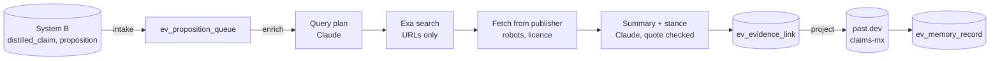

# How System C works

System C (`backend/evidencegraph/`) checks the claims that System B extracts from politicians' social-media posts.
For each claim it searches the web, reads the pages it finds, and records whether each page supports or contradicts
the claim. Postgres keeps the full record. past.dev receives the claim together with its evidence, so agents and
analysts can ask dated questions such as "what did we know about this claim on date D?".

The full design, including later milestones, is in [`System_C_Design_Doc_for_Devin.md`](System_C_Design_Doc_for_Devin.md).
This page describes what is built today.

## Where it sits

| System | Owns | System C reads / writes |
| --- | --- | --- |
| A, `polgraph` | Politicians, offices, the shared Exa gateway | Uses `polgraph.exa_gateway.ExaGateway` and `polgraph.ids` (`source_id`, `canonical_url`) |
| B, `socialclaims` | Posts, claims (`distilled_claim`), propositions | Reads them with SQL (read-only) |
| C, `evidencegraph` | `ev_*` tables, evidence, the past.dev projection | Writes `ev_*` tables and past.dev |

All three systems share one Postgres database (local `socialclaims`, or Neon for Modal runs). System C's tables all
start with `ev_`, and its migrations are tracked separately in `ev_schema_migrations`.

## Pipeline



### 1. Intake: which claims get checked (`intake`, free)

`intake` (in `intake.py`, SQL in `sql/intake.sql`) groups System B's claims by proposition: the normalised statement
that several claims can share. It upserts one row per proposition into `ev_proposition_queue`. It counts only:

- claims from the latest successful extraction of each post and politician, so older extractor runs don't double count;
- claims with `grounding = 'exact'`, meaning the quote was found in the transcript or caption;
- claims with modality `asserted` or `quoted`. Questions and satire are excluded.

A proposition is `queued` when it has a checkable claim with check-worthiness ≥ `INTAKE_MIN_CHECKWORTHINESS` (0.5).
Checkable means factual, statistic, accusation, or a commitment whose deadline has passed. Otherwise it is `skipped`,
with a reason: `below_checkworthiness`, `commitment_deadline_pending`, `not_currently_verifiable` (opinions, forecasts,
policy positions) or `no_current_claims`.
`priority = check-worthiness × ln(1 + total views of the posts)`. Re-running intake is safe: rows already `mapped`
by the current `MAPPER_VERSION` stay mapped unless newer claims arrive.

### 2. Discovery: finding pages (`enrich`, billed)

For each queued proposition, in priority order, Claude (`ENRICH_MODEL`) writes one short search query per row of the
query plan. Rows that don't apply are skipped.

| Row | Looks for | Exa restriction |
| --- | --- | --- |
| `neutral` | News coverage of the claim | `category: news`, located in MX |
| `counter` | The opposite outcome | located in MX |
| `primary` | The official record of the act or figure | registry domains of class `government_publication`, `legislative_judicial` |
| `indicator` | The dataset or bulletin behind a statistic | `official_statistics` domains |
| `fact_check` | Earlier fact-checks of the same claim | `fact_check` domains |
| `expert` | Analysis of a policy, accusation or statistic | `think_tank_ngo`, `academic` domains |
| `english` | International coverage | none |

The domain lists come from the source registry (`ev_source_registry`, seeded from `registry/MX.json` by
`load-registry`). Each row is one Exa search through the shared gateway, under purpose `ev:claim`, which counts
against the System C monthly budget `EV_EXA_MONTHLY_BUDGET_USD` and the shared 8 requests/s limiter. The search asks
for **no page text and no highlights**. Only the URL, title, date, author and score are kept, in `ev_exa_request` and
`ev_discovered_url`, because Exa's terms don't allow storing its text output. Unrestricted rows exclude social
platforms and block-listed domains.

Results are merged across rows by rank and de-duplicated by canonical URL. At most `ENRICH_MAX_DOCUMENTS` (8) pages
per proposition are kept, with `ENRICH_RESULTS_PER_QUERY` (5) results per search.

### 3. Fetching: reading the pages ourselves (`fetch.py`)

Each URL is fetched from its publisher by `Fetcher`:

- **Rules:** it follows `robots.txt`, waits at least `FETCH_MIN_INTERVAL_S` between requests to the same host, follows
  at most 5 redirects itself, and stops at `FETCH_MAX_BYTES`.
- **Blocked pages:** HTTP 401/402/403/451, login or CAPTCHA pages, and block-listed domains are recorded as `blocked`.
  Other failures are retried up to 3 times with backoff.
- **Document IDs:** a document's ID is System A's `source_id(url)`. A different canonical or redirect target becomes a
  second document, linked to the first by a `SAME_AS` edge in `ev_kg_edge`.
- **Dates:** taken from page metadata (JSON-LD, meta tags), then the URL pattern, then Exa's date. The origin and
  confidence are stored in `ev_document`.
- **Versions:** every distinct page text becomes a row in `ev_document_version` (content hash, retrieval time, simhash
  for near-duplicate clustering).

**Storage policy:** full text is written to `SNAPSHOT_DIR` only when the registry licence allows it (`open_gov`,
`open_access`). For copyrighted or unknown sources, the text is processed in memory and then dropped.

### 4. Judging: summary and stance (`enrich.py`)

Claude reads each fetched page, truncated to `ENRICH_PAGE_CHARS`, next to the claim, and returns:

- `summary`: 1–3 sentences in Spanish, in its own words, of what the page reports on the claim's subject;
- `stance`: `supports`, `contradicts`, `context` (true but missing a qualification, scope or period), or `irrelevant`;
- `quote`: the exact sentence the stance rests on;
- `rationale` and `confidence`.

The quote is checked against the fetched text after normalising accents, case and punctuation. If it isn't found,
the judgement is kept with `quote_verified = false` and is never sent to past.dev. Results go to `ev_evidence_link`,
one row per proposition × document version × `MAPPER_VERSION`. A re-run reuses an existing row instead of calling
Claude again.

### 5. Writing to past.dev (`project.py`)

Claims reach past.dev **only** through this step, after their evidence has been judged. Nothing copies Postgres to
past.dev in bulk. Each record is plain text followed by `JSON:` and a compact payload.

| Record | ID | Timestamp | Audience | Text |
| --- | --- | --- | --- | --- |
| Claim | `clm-<proposition hash>-<person slug>` | first `stated_at` | `pol-<slug>` | `CLAIM by or about {name} ({date}): {canonical text}` plus up to 5 quotes with post links |
| Document | `doc-<source hash>-v<n>` | `published_at` (retrieval time if unknown, flagged) | none: visible project-wide | `DOCUMENT by {publisher} ({class}, tier {t}) published {date}: {title}. {url}` plus the summary |
| Evidence link | `lnk-<link hash>-<person slug>` | `assessed_at` | `pol-<slug>` | `EVIDENCE: {publisher} ({date}) SUPPORTS/CONTRADICTS/CONTEXT the claim …` plus reason, quote and source |

- **What gets sent:** only links with a verified quote and a stance other than `irrelevant`, plus their documents.
  A claim mentioning several politicians gets one claim record and one link record per politician.
- **Quotes:** they follow the storage policy. Open licences keep the full quote; `copyright` allows at most 300
  characters, `unknown` at most 200, and `licensed` none.
- **Audiences:** each politician has a rule audience `pol-<slug>` (at most 40 characters). It reaches identities whose
  `politician` trait is that person, or whose `scope` trait is `country`. Each audience also gets a reader identity,
  `reader-pol-<slug>`. An existing audience is reused only if every identity in it reads the same politician.
- **Sending:** items go to `POST /ingest/batch` (up to 1,000 items) with a content-derived `idempotencyKey`, then
  `GET /ingest/{id}` is polled until `completed` or `failed`.
- **Tracking:** past.dev has no route that lists data points, so every ID, its ingestion, status and content hash is
  stored in `ev_memory_record`. Unchanged items are not resent. Ingestions an earlier run left `queued` are
  re-checked (for the same `claims-<cc>` project only), and failed ones are resent.

The old Brugada posts in past.dev (`oriane:<id>:v1`, from an earlier pipeline) are left as they are.

The proposition is then marked `mapped` in the queue. If any step fails, it goes back to `queued` and the batch moves
on to the next proposition.

## Tables

| Table | Holds |
| --- | --- |
| `ev_proposition_queue` | Checkable propositions, priority and status (`queued`, `mapping`, `mapped`, `skipped`) |
| `ev_source_registry` | Domains with source class, authority tier, licence class, allow/block list |
| `ev_exa_request`, `ev_discovered_url` | Every Exa search (parameters, cost, latency) and its result URLs, without text |
| `ev_fetch_queue` | Fetch status, attempts and retry time per URL |
| `ev_document`, `ev_document_version` | Fetched documents, their dates and licence, and each distinct version |
| `ev_kg_edge` | Graph edges (currently `SAME_AS`) |
| `ev_evidence_link` | Summary, stance, quote and verification per proposition × document version |
| `ev_memory_record` | Every data point sent to past.dev |

## Commands

Run from `backend/` (or prefix `make`, see the targets in parentheses):

```sh
../.venv/bin/python -m evidencegraph migrate                             # (make ev-migrate) create/upgrade ev_ tables
../.venv/bin/python -m evidencegraph load-registry --country MX          # seed the source registry
../.venv/bin/python -m evidencegraph intake                              # free: refresh the queue from System B
../.venv/bin/python -m evidencegraph queue --status queued --limit 20    # inspect the queue
../.venv/bin/python -m evidencegraph enrich --dry-run --limit 10         # free: next propositions and cost ceiling
../.venv/bin/python -m evidencegraph enrich --limit 10 --confirm-spend   # (make ev-enrich ARGS=...) billed
../.venv/bin/python -m evidencegraph fetch https://www.inegi.org.mx/     # fetch one URL (no Exa)
```

On Modal: `make modal-systemc ARGS="enrich --limit 10 --confirm-spend"`. The Modal secret `prm-secrets` supplies
`DATABASE_URL` (Neon) and the API keys.

## Cost and safety gates

- **Free dry run:** `enrich --dry-run` makes no external calls and writes nothing. It lists the next propositions and
  a cost ceiling.
- **Ceiling per proposition:** 7 Exa searches (about $0.007 each) and 1 + `ENRICH_MAX_DOCUMENTS` Claude calls. That's
  roughly $0.32 at an assumed $3 / $15 per million input / output tokens, plus past.dev ingest credits (1 credit per
  350 bytes; a proposition with 8 linked documents writes about 15–20 records).
- **Confirmation:** a paid run needs `--confirm-spend` and `EXA_API_KEY`, `ANTHROPIC_API_KEY` and `PAST_DEV_API_KEY`.
  `--limit` caps how many propositions are processed.
- **Budget:** Exa spend also stops at the System C monthly budget in the gateway.

## Configuration

Settings are read from the repository `.env` by `EvidenceSettings` (`config.py`). The main ones:

| Variable | Default | Meaning |
| --- | --- | --- |
| `DATABASE_URL` | local `socialclaims` | Shared Postgres |
| `EXA_API_KEY`, `ANTHROPIC_API_KEY`, `PAST_DEV_API_KEY` | — | API keys |
| `ENRICH_MODEL` | `claude-sonnet-5-5` | Model for query plans and judgements |
| `ENRICH_MAX_DOCUMENTS` | 8 | Pages judged per proposition |
| `ENRICH_RESULTS_PER_QUERY` | 5 | Exa results per search |
| `ENRICH_PAGE_CHARS` | 24000 | Page text sent to Claude |
| `MAPPER_VERSION` | `m1` | Version stamp; changing it re-judges and re-queues mapped propositions |
| `INTAKE_MIN_CHECKWORTHINESS` | 0.5 | Queue threshold |
| `EV_EXA_MONTHLY_BUDGET_USD` | 30 | System C Exa budget per month |

## Not built yet

These are in the design doc but not implemented:

- standing (topic-based) discovery and registered feeds;
- assertion and observation extraction from documents, statistics adapters, and embeddings or vector search;
- the per-proposition assessment label (`supported`, `contradicted`, …) and the advocate–critic review;
- as-known views from archive snapshots;
- `past.dev` recall as a retriever.

Today, System C judges stance per document only.
