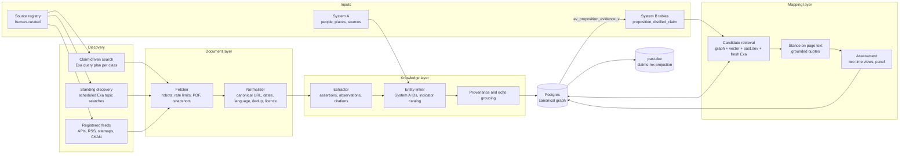

# Implementation brief for Devin (read first)

This file is the complete design for **System C, the Evidence Knowledge Graph**. System C finds documents online (news, official statistics, government publications, legislative and court records, think-tank and NGO reports, university publications, fact-checks, polls), turns them into a timestamped knowledge graph, stores that graph in Postgres with a projection in past.dev, and maps every claim produced by System B against it.

System A (political knowledge graph) and System B (social claims pipeline) are specified elsewhere. System C reads from both and writes evidence maps and preliminary assessments back for System B to show.

**This doc replaces the "Claim validation with Exa" section of the System B design doc.** Where they differ, this doc wins. System B keeps capture, claim distillation, propositions and claim memory.

**Files that go with this doc**

- [`docs/system_b/System_B_Design_Doc_for_Devin.md`](../system_b/System_B_Design_Doc_for_Devin.md): System B design (claim and proposition contracts, past.dev layout, Mexico corpus sources in its Appendix A).
- [`README_GRAPH.md`](../../README_GRAPH.md): System A graph structure (Person, GovernmentLevel and Source IDs, `authority_tier`).

**Where it goes in the repository** (`kolumba-ai/political-research-monitor`, branch `systemA-knowledge_graph`, read on 2026-11-15 at `651c153`)

The repo already holds System A (`backend/polgraph`) and System B Phases 0–3 (`backend/socialclaims`: capture, segments, speaker roles, claims and propositions; no Exa validation or past.dev writes yet). Build System C the same way:

| Item | Convention to follow |
| --- | --- |
| Package | `backend/evidencegraph/`, CLI `python -m evidencegraph`, tests in `backend/tests/evidencegraph/` |
| Config | pydantic-settings class reading the shared repo `.env`, like `socialclaims/config.py` (`EXA_API_KEY`, `ANTHROPIC_API_KEY`, `DATABASE_URL` are already used there; add `PAST_DEV_API_KEY`) |
| Database | The same Postgres as System B (`DATABASE_URL`), psycopg 3, plain SQL migrations in `backend/evidencegraph/migrations/NNN_*.sql`. **Prefix every System C table with `ev_`** (System B already owns `run`, `review`, `proposition`…) |
| Make targets | `ev-migrate`, `ev-test`, `ev-dry-run`, mirroring the `sc-*` targets |
| Exa | Only through `polgraph.exa_gateway.ExaGateway`, which is documented as the only module that talks to Exa (cache, cost ledger, budgets, rate limiter, retries). Required gateway changes are listed under "Exa usage rules" |
| IDs | `polgraph.ids.source_id(url)` for documents (`source:` + first 16 hex chars of SHA-1 of `polgraph.ids.canonical_url(url)`); `polgraph.ids.level_id` / `person_id` for System A nodes; never re-implement them |
| Authority tier | `polgraph.evidence.authority_tier(url)` as the default tier; the System C registry may override it per domain |
| LLM | Same client pattern and model setting as `socialclaims/claims.py` (`claude-sonnet-5-5`, tool-use structured output, stored raw responses, versioned prompts, regrade without new LLM calls) |
| Logging | `structlog`, as in both packages |
| Design doc location | Suggested: `docs/system_c/` next to `docs/system_b/` |

**Secrets (environment variables; never commit them; `.env` is git-ignored, mode 600)**

| Variable | Service | Auth header | Status |
| --- | --- | --- | --- |
| `EXA_API_KEY` | Exa, `https://api.exa.ai` | `x-api-key: <key>` | Working |
| `PAST_DEV_API_KEY` | past.dev project key, `https://api.past.dev/api/v1` | `Authorization: Bearer <key>` | Working |
| `PAST_DEV_MANAGEMENT_KEY` | past.dev organization key (`past_mk_`), to create the `claims-<country>` projects | `Authorization: Bearer <key>` | **Not yet issued** |
| `ANTHROPIC_API_KEY` | Claude, for extraction, stance and panel calls | `x-api-key: <key>` | Already read by System B (`socialclaims/config.py`); reuse the same variable |

**Facts verified with disposable pilots on 2026-11-14/15** (details in Appendix B)

- Exa: 60 searches (10 real claims × 6 source classes), zero errors, $0.007 per search with highlights, median latency 1.6 s (p90 2.9 s). At 6 parallel requests we got 2.8 searches/s; reaching the 10 QPS account limit needs about 16 in flight.
- Claim-text search finds news and government pages, not statistics, think tanks or fact-checks: of 180 judged top results, 45 addressed the claim directly, and none of those came from statistics or think-tank searches. 9 of 10 claims had at least one independent direct source, but most of that support was journalism repeating the government's own figures. No result refuted any claim.
- past.dev: a batch of 11 graph data points was searchable 25 s after sending; recall takes 0.7–0.9 s; `queryTimestamp` correctly hides documents published after a given date. past.dev derives its own claims, mentions and time anchors from document text, credited to the publisher, but it does not store typed edges between our nodes and cannot filter by metadata.

**MVP scope**

- Mexico, Spanish, Mexico City first (the Clara Brugada pilot data in `data/pilot/` is the first test set).
- Internal only: Mexico is `research_only` in System A until its expanded democracy gate ships. Evidence-only export; no verdict labels leave the system.

**Do not**

- Publish anything, or contact any person or organization.
- Store Exa result text (highlights, summaries, page text) beyond the request that produced it. Exa finds URLs; System C fetches pages from the publisher itself.
- Store full text of copyrighted documents (news, most think-tank and academic work) unless the source registry marks the licence as allowing it. Store metadata, our extracted assertions, and short quotes.
- Bypass paywalls, logins, CAPTCHAs or `robots.txt`.
- Create politician identities. People and places come from System A IDs.

**Blocking open questions:** see "Open questions" at the end. The first three (past.dev management key, the Exa gateway changes, legal sign-off on the storage policy) were resolved on 2026-11-14.

---

# System C: Evidence Knowledge Graph — Design Doc

Author: Mauricio Roman · Status: draft for implementation · 2026-11-15

## Overview

System B turns social posts into claims, for example "Mexico City closed October 2026 with the fewest homicides in 29 years." System C answers: *what does everything else published say about this, when was it said, by whom, and how independent is it?*

It does this in three layers:

1. **Document layer.** Find documents (Exa plus scheduled feeds from known sources), fetch them from the publisher, record when they were published, revised and retrieved.
2. **Knowledge layer.** Extract what each document asserts (statements with a speaker) and measures (statistical observations), linked to System A people and places, and to each other through citation and derivation.
3. **Mapping layer.** Link each System B proposition to the assertions and observations that support, contradict or add context to it, group sources that are really one origin, and produce an evidence map and preliminary assessment for two time views: as known when the claim was made, and as known now.

Postgres holds the canonical graph. past.dev holds a timestamped projection of it, so agents and analysts can ask "what was known about X on date D" and get dated, sourced answers.

**What the pilot taught us, and how the design responds**

| Finding | Design response |
| --- | --- |
| Top "news" results for a government claim are the government's press release and outlets rewriting it | Independence is decided by provenance (who the figure is attributed to, what the document cites), not by domain. Echo groups count as one source |
| Claim-text searches in statistics, think-tank and fact-check domains return topical but not direct evidence | Statistics come from structured datasets as `observation` nodes, matched by indicator, place and period. Think tanks, academia and fact-checkers are ingested ahead of time as standing corpora, then matched to claims |
| Highlights are truncated; judging from snippets missed figures | Stance is judged on the fetched page text, never on Exa highlights alone |
| Many statistics pages carry no publish date (7 of 100) | Dates come from dataset metadata (CKAN, INEGI release calendars), page metadata, then Exa's date, in that order; undated evidence is marked and down-weighted |
| No refutations in 10 claims | Every claim gets an explicit counter-evidence query and a data check where an indicator exists; "no refutation found" is recorded as a search result, never as support |

## Goals and non-goals

**Goals**

- G1. For each checkable proposition from System B, an evidence map with supporting, contradicting and context evidence, each item dated, sourced, typed and grouped by independence.
- G2. A reusable knowledge graph of documents, assertions and observations that grows independently of claims, so later claims are matched against evidence already collected.
- G3. Two time views for every assessment: as known when stated, and current.
- G4. Every node and edge timestamped (event time and knowledge time) and reproducible from stored inputs.
- G5. A past.dev projection that answers dated questions per politician and per country.

**Non-goals (v1)**

- Publishing verdicts. Labels stay internal; export is evidence-only.
- Crawling the open web ourselves. Discovery is Exa plus registered feeds.
- Video, audio and image evidence. Text and tabular data only.
- Countries other than Mexico.

## Boundaries with System A and System B

| System | Owns | System C reads | System C writes |
| --- | --- | --- | --- |
| A — political graph | Countries, levels, offices, people, parties, terms, their `Source` nodes | Person, GovernmentLevel, Office IDs and aliases; `authority_tier`; `pipeline_mode` | Nothing. Proposed new people or places go to a review queue for System A |
| B — social claims | Posts, claims, propositions, speaker roles, claim memory | `proposition` and `distilled_claim` rows (read-only SQL on the shared database) | `ev_evidence_map` and `ev_assessment` per proposition and time view, read by System B's export and review UI |
| C — evidence graph | Documents, assertions, observations, evidence links, assessments, the source registry | — | — |

**Source IDs are shared.** A document's ID is System A's: `polgraph.ids.source_id(url)`, i.e. `source:` + the first 16 hex characters of SHA-1 over `polgraph.ids.canonical_url(url)` (lowercased scheme and host, no fragment, no `utm_*`/`fbclid`/`gclid`, no trailing slash). Compute it from the URL as discovered, exactly as System A does, so a page cited by both systems is one source. Redirect targets and `rel=canonical` URLs found while fetching are stored as `resolved_url`; when they hash differently they become a second `ev_document` linked by `SAME_AS`, never a replacement ID.

**Intake from System B (no change to System B needed).** System B Phase 3 writes `proposition` (key: `proposition_id`, the first 24 hex characters of SHA-256 over the normalized subject, predicate, negation, values with units, place, period and qualifiers; columns `canonical_text`, `subject`, `predicate`, `negated`, `vals`, `place`, `period_start`, `period_end`, `qualifiers`, `topic_id`, `first_stated_at`) and `distilled_claim` (with `proposition_id`, `politician_id`, `type`, `topics`, `checkworthiness`, `modality`, `grounding`, `stated_at`, `referenced_period_start/end`, `extractor_version`). Propositions carry no politician or checkworthiness; those come from their claims. System C's `intake` worker runs this selection on a schedule and upserts into `ev_proposition_queue`:

- at least one `distilled_claim` with `grounding = 'exact'` (claims marked `review` wait for System B's review; `failed` never enter);
- claim `type` in `factual`, `statistic`, `accusation`, `commitment` (commitments only once their deadline in `period_end` has passed); `policy_position`, `forecast` and `opinion` are recorded as `not_currently_verifiable` without searching;
- `modality` in `asserted`, `quoted` (not `questioned` or `satire`);
- max `checkworthiness` ≥ 0.5;
- not already mapped by the current `mapper_version`, or a claim newer than the last map exists.

Queue fields: `proposition_id`, politicians (from `distilled_claim.politician_id`), `stated_at` = earliest claim `stated_at` (equals `proposition.first_stated_at`), topics, max checkworthiness, reach (sum of latest `post_metrics.views` over the claims' posts), priority = checkworthiness × log(1 + reach), status, timestamps.

System C writes results only to `ev_` tables. System B's export later reads them through a view (`ev_proposition_evidence_v`); no outbox or broker in v1.

## Architecture

Services (all Python, one repo, deployable as separate workers sharing Postgres):

| Worker | Trigger | Does |
| --- | --- | --- |
| `intake` | Cron (every 15 min) | Selects checkable propositions from System B tables into `ev_proposition_queue` |
| `discover_claim` | `ev_proposition_queue` row | Builds the query plan, calls Exa, enqueues URLs |
| `discover_standing` | Cron (daily / weekly per topic) | Topic and source-class searches with date windows; enqueues URLs |
| `feeds` | Cron per registry entry | Polls APIs, RSS, sitemaps and CKAN for new documents and dataset releases |
| `fetch` | `fetch_queue` | Fetches from the publisher, stores snapshot, writes `document_version` |
| `extract` | New `document_version` | Assertions, observations, citations, entities |
| `map` | New proposition, or new evidence touching a mapped proposition | Candidate retrieval, stance, assessment |
| `project` | New or changed graph rows | Writes past.dev data points, records them in `memory_record` |

## Source universe and registry

"Any and all documents" is bounded by what Exa indexes plus what we register. System C measures that coverage (see Evaluation) instead of assuming it.

**Source classes**

| Class | Examples (Mexico) | Primary use | Default licence class |
| --- | --- | --- | --- |
| `official_statistics` | INEGI (incl. ex-CONEVAL), Banxico, SESNSP, IMSS, datos.gob.mx, datos.cdmx.gob.mx, SHCP Transparencia Presupuestaria | Observations: the numbers | `open_gov` |
| `government_publication` | gob.mx ministries, jefaturadegobierno.cdmx.gob.mx, SSC CDMX, DOF/SIDOF, Gaceta Oficial CDMX | What the government said or decreed | `open_gov` |
| `legislative_judicial` | Congreso CDMX, Cámara de Diputados, Senado, SCJN, TEPJF, INE | Votes, bills, rulings, finance records | `open_gov` |
| `news` | El Universal, Reforma, Milenio, La Jornada, Animal Político, Proceso, El País México, wires (EFE, Reuters, AP) | Reporting, independent figures, reactions | `copyright` (wires: `licensed` once contracted) |
| `fact_check` | Verificado, El Sabueso (Animal Político), AFP Factual, EFE Verifica; Google Fact Check Tools API | Prior verdicts on same or similar claims | `copyright` |
| `think_tank_ngo` | México Evalúa, IMCO, Causa en Común, MCCI, Fundar, Observatorio Nacional Ciudadano, CEPAL, Wilson Center, InSight Crime | Independent analysis and datasets | `copyright` unless the publisher states an open licence |
| `academic` | UNAM, COLMEX, CIDE, ITAM, Ibero, UAM, FLACSO, SciELO México, Redalyc | Research findings, methods | `open_access` when CC-licensed, else `copyright` |
| `polling` | Enkoll, El Financiero, CE Research, Mitofsky, Demoscopia Digital | Approval and voting-intention claims | `copyright`; methodology fields required |
| `international` | World Bank, OECD, UN agencies, IMF | Cross-country context | Per publisher |

**Registry (`source_registry`).** One row per domain or feed: class, publisher name, `authority_tier` (System A scale: 1 official, 2 reference or press, 3 other), licence class, `can_store_full_text`, robots status, crawl delay, feed type and URL, `is_claimant_for` (the entities whose own performance this source reports, e.g. jefaturadegobierno.cdmx.gob.mx → Mexico City government), allow/block status, notes, `added_by`, `reviewed_at`. Qualified humans maintain it through a reviewed change log; the pipeline never edits it. Seed lists are in Appendix A.

Unregistered domains found by Exa are allowed as evidence with tier 3 and licence class `unknown` (metadata and short quotes only), and are queued for registry review once they appear in 3 or more evidence maps.

## Discovery

### 1. Claim-driven search (per proposition)

Runs when a proposition arrives, in priority order (System B's checkworthiness × reach). One proposition repeated in many posts is searched once.

**Query plan (LLM, structured output).** From the proposition's subject, predicate, values, place and period, generate one query per row. Rows marked *if applicable* are skipped when the proposition has no matching feature; skipped rows are logged with the reason.

| Row | Purpose | Exa parameters |
| --- | --- | --- |
| Neutral restatement (Spanish) | Reporting on the claim | `category: news`, `userLocation: MX` |
| Counter-evidence | Explicitly look for the opposite: "aumentaron homicidios CDMX octubre 2026" | `type: auto`, `userLocation: MX` |
| Primary source | Official record of the act or figure | `includeDomains` = registry `government_publication` + `legislative_judicial` |
| Indicator query *(if a statistic)* | Dataset or bulletin for the indicator, not the claim wording: "SESNSP incidencia delictiva CDMX homicidio doloso octubre 2026" | `includeDomains` = registry `official_statistics` |
| Prior fact-checks | Same or similar claim checked before | `includeDomains` = registry `fact_check`; also Google Fact Check Tools `claims:search` |
| Expert analysis *(if policy, accusation or statistic)* | Topic-level query: "evaluación propuesta robo menor cuantía CDMX impunidad" | `includeDomains` = registry `think_tank_ngo` + `academic` |
| English restatement *(if high reach)* | International coverage | `type: auto` |

Shared parameters: `numResults: 10`; `excludeDomains` = social platforms (tiktok.com, instagram.com, facebook.com, x.com, youtube.com) plus the registry block list, unless `includeDomains` is set. For the *as-known* view add `endPublishedDate = stated_at`; for the *current* view no end date.

Request highlights only to rank and route URLs. Discard Exa text after the request; persist only URL, title, Exa's published date, author, score, request ID and cost.

### 2. Standing discovery (builds the graph ahead of claims)

Claims about water, crime or budgets keep recurring. Collecting the relevant evidence before the claims arrive is cheaper and finds sources that claim-text queries miss (the pilot's statistics and think-tank gap).

- **Topic searches.** For each topic in System B's country taxonomy (`socialclaims/taxonomy/MX.json`: 31 topics such as `seguridad`, `agua`, `finanzas_publicas`, `vivienda_servicios`; skip `otro`), weekly Exa searches per source class with `startPublishedDate` = last run. 30 topics × 6 classes × 4 weeks ≈ 720 searches a month ≈ $5. Use the same topic IDs on `ev_assertion` so claims and evidence share one taxonomy.
- **Politician searches.** For each politician in scope, weekly news and analysis searches on their name and office, so coverage that never matches a specific claim is still in the graph.
- **Registered feeds.** RSS, sitemaps, APIs and CKAN catalogs from the registry, polled on each source's cadence (System B Appendix A lists Mexico's: INEGI and Banxico APIs, DOF/SIDOF, datos.gob.mx and IMSS CKAN, SHCP and SESNSP bulk files, Verificado RSS, Presidency transcripts, Congress gazettes).

### 3. Exa usage rules

All calls go through `polgraph.exa_gateway.ExaGateway`. Read on 2026-11-15, it needs these changes before System C uses it (coordinate with System A's owner, since both systems depend on it):

| Today | Needed | Why |
| --- | --- | --- |
| `search()` accepts query, `num_results`, include/exclude domains, `start_published_date`, `type`, text and highlights | Add `end_published_date`, `category`, `user_location`, and highlights options (`query`) | Claim-driven plan and the as-known view |
| Rate limiter is in-process (`_RateLimiter`, `EXA_REQUESTS_PER_SECOND` default 4) | A limiter shared across processes: a Postgres-backed token bucket (one row per API key, `SELECT … FOR UPDATE`), used by System A and System C | System C runs several workers; per-process limiters would add up past 10 QPS |
| Persistent SQLite cache (`var/exa_cache.sqlite3`) stores whole responses, including page text (search `text_chars` default 6,000; `contents` 40,000), for 7 days | For System C: call `search()` with `text_chars=None`, and cache only URL, title, date, author, score and request ID. Add a gateway option to store responses without text or highlights | Exa terms: no storing outputs without written permission. Also flag System A's own cache for the same review |
| Budget: `EXA_RUN_BUDGET_USD` 15, `EXA_TOTAL_BUDGET_USD` 45 lifetime, shared | Per-system budgets via the `purpose` field (`ev:claim`, `ev:standing`), with a monthly cap instead of a lifetime cap | The $45 lifetime cap would stop System C within weeks |
| Usage ledger in the SQLite file | Also write each System C call to `ev_exa_request` in Postgres | Joins with propositions and evidence maps |

Rules once those exist:

- One shared limit, set to 8 requests/s (under the 10 QPS limit; raise when Exa raises it). Keep about 16 requests in flight to use it, since median latency is 1.6 s.
- Claim-driven searches get priority over standing discovery in the limiter queue.
- Retries on 429/5xx with exponential backoff and jitter, max 3.
- Every call logged in `exa_request` with request ID, parameters hash, latency, result count and `costDollars`.
- `type: deep` with `outputSchema` only as a second opinion on selected high-reach propositions, never as evidence by itself.

## Document layer

### Fetching

- Fetch each URL from the publisher with our own user agent (generic, no personal data), honouring `robots.txt` and the registry crawl delay, max 1 request/s per domain.
- HTML: extract main text (readability-style), title, author, `datePublished`/`dateModified` from JSON-LD, Open Graph and `<meta>`, canonical URL, language, outbound links.
- PDF: text extraction with page numbers; OCR only for registry sources marked scanned.
- Tables and datasets (CSV, XLSX, JSON, CKAN resources): parsed into `observation` rows by per-source adapters (see Observations), not by the LLM.
- Paywalled or blocked pages: record `fetch_status = blocked` with the Exa metadata. Such a document can be shown as a lead, never used as stance evidence.

### Snapshots and versions

Every fetch writes a `document_version` with content hash, retrieval time and, where licence allows, the text in object storage. A changed hash creates a new version; the old one is kept. This gives the *as-known* view real page states instead of today's text. For pages first seen after the claim date, query an archive snapshot (Internet Archive availability API, or Exa `contents.snapshotAsOf` once confirmed on our plan) and mark the view provisional when none exists.

### Normalization

- **Document ID**: `polgraph.ids.source_id(discovered_url)` (see Boundaries). Redirect targets and `rel=canonical` are kept as `resolved_url`, with a `SAME_AS` document when they hash differently.
- **Dates**, with their origin recorded: `published_at` from page metadata → dataset metadata → URL pattern → Exa date; `modified_at` when present; `retrieved_at` always. Missing `published_at` is `null` with `date_confidence = none`.
- **Near-duplicates**: SimHash on main text; documents above 0.9 similarity join a `dup_cluster` (syndicated wire copies, republished press releases).
- **Licence class and storage**: applied from the registry at write time (see Rights).

## Knowledge layer

### Graph model

Nodes and edges are Postgres rows. Every node and every edge carries two kinds of time:

- **Event time**: when the thing happened or was published (`published_at`, `period_start`/`period_end`, `stated_at`).
- **Knowledge time**: when System C learned or concluded it (`retrieved_at`, `extracted_at`, `assessed_at`), plus `valid_from`/`valid_to` for superseded rows (bitemporal; rows are never updated in place).

**Node types**

| Node | Key | Holds |
| --- | --- | --- |
| `document` | `polgraph.ids.source_id(url)` | URL, title, publisher, authors, class, tier, licence, language, `published_at`, `modified_at`, `date_origin`, `dup_cluster_id` |
| `document_version` | `document_id`, `content_sha256` | Snapshot path (if storable), `retrieved_at`, fetch status, archive origin |
| `publisher` | registry domain | Name, class, tier, `is_claimant_for[]` |
| `entity` | System A ID, or `org:`/`indicator:`/`place:` IDs we mint | Name, aliases, type. People and government levels must be System A IDs |
| `assertion` | `assertion_id` | One statement in a document: normalized text (es/en), verbatim quote with character offsets, speaker or attributed source ("según la SSC"), subject entity, predicate, values with units, place, period, modality (asserted, reported, denied, projected), `extracted_at`, `extractor_version` |
| `observation` | `observation_id` | One data point: `indicator_id`, place (System A level ID), period, value, unit, measure (count, rate, %), methodology note, release (document version), `released_at`, `revision_of` |
| `indicator` | `indicator:<country>:<slug>` | Name, unit, source series code (e.g. INEGI BIE ID, SESNSP crime type), methodology breaks with dates |
| `independence_group` | `group_id` | Documents and assertions that trace to one origin |
| `proposition` | System B ID (mirrored) | Canonical text and structured fields from System B |
| `evidence_link` | `link_id` | Proposition ↔ assertion or observation, with stance and reasons (detailed under Mapping) |
| `assessment` | `assessment_id` | Label, confidence, time view, rationale, evidence link IDs |

**Edge types**

| Edge | From → To | Meaning |
| --- | --- | --- |
| `PUBLISHED_BY` | document → publisher | |
| `AUTHORED_BY` | document → entity | |
| `HAS_VERSION` | document → document_version | |
| `CONTAINS` | document_version → assertion / observation | Where it was read, with offsets or table cell |
| `ATTRIBUTED_TO` | assertion → entity | Who the statement or figure comes from; drives independence |
| `ABOUT` | assertion / observation → entity | Subject, place, indicator |
| `CITES` | document → document | Outbound links and named sources ("con datos del SESNSP") |
| `DERIVED_FROM` | assertion → assertion / observation | Same figure traced back to its origin |
| `SAME_AS` | document → document | Near-duplicate or syndicated copy |
| `MEMBER_OF` | document / assertion → independence_group | |
| `SUPPORTS` / `CONTRADICTS` / `CONTEXT_FOR` | evidence_link materialized as edges for queries | |
| `ASSESSED_AS` | proposition → assessment | Per time view, append-only |

**Storage.** Two generic tables (`ev_kg_node`, `ev_kg_edge`) with typed JSONB payloads and type-specific tables for the hot paths (`ev_assertion`, `ev_observation`, `ev_evidence_link`), all in the same Postgres as System B with pgvector for embeddings. Recursive CTEs handle provenance walks (depth ≤ 4). System A keeps its own `GraphStore` (SQLite by default, Neo4j optional, `GRAPH_BACKEND`); System C does not write to it. System C reads System A through the same paths System B uses (`socialclaims/systema.py`: knowledge-base export, bundles, or the live store), and System A IDs appear in System C rows as plain strings.

### Extraction

One LLM call (Claude, structured output) per document version, chunked for long documents, with the registry class and the System A entity profiles of people mentioned. Output per document:

- **Assertions**: only statements about public matters in scope (people, places or topics in the taxonomy). Each must quote a verbatim span; the grounding check (exact span match, then entailment of the normalized text by the quote, as in System B) drops any that fail.
- **Attribution**: who the statement comes from. "La SSC informó que…" attributes to SSC CDMX, not to the outlet. Unattributed statements in news are attributed to the outlet.
- **Citations**: named data sources and linked documents become `CITES` edges.
- **Figures in prose** ("46 homicidios en octubre") become assertions with values; they do not become observations unless the document is the official release of that indicator.

### Observations (structured statistics)

Statistical claims are checked against data, not against articles about data. Per-source adapters (one module per registry dataset) load releases into `observation` rows:

| Adapter | Source | Indicators (examples) |
| --- | --- | --- |
| `sesnsp_incidencia` | SESNSP municipal and state crime incidence (monthly bulk) | Homicidio doloso, robo, by month and state/municipality; flag the 2026 methodology break |
| `inegi_bie` | INEGI Banco de Indicadores API | Unemployment, inflation, ENSU perceived insecurity (quarterly), poverty |
| `banxico_sie` | Banxico SIE API | Exchange rate, rates |
| `shcp_presupuesto` / `cdmx_presupuesto` | SHCP and CDMX budget open data | Budget by program and agency (approved, modified, spent) |
| `ckan_generic` | datos.gob.mx, datos.cdmx.gob.mx | Per-dataset mapping config |

Each observation keeps the release it came from and its `released_at`. A revised figure is a new observation with `revision_of`, so the *as-known* view uses the figure published before `stated_at`.

The **indicator catalog** maps phrases to indicators ("homicidios", "homicidio doloso", "asesinatos" → `indicator:MX:homicidio-doloso`) and lists each indicator's place granularity and period type. It is maintained with the registry.

### Entity linking

- People and government levels: System A IDs through aliases plus office context; ambiguous mentions go to review, never guessed.
- Organizations (ministries, parties, companies, NGOs): minted `org:` IDs, with System A party IDs where they exist.
- Places below System A's coverage (System A has 10 municipalities): minted `place:` IDs with INEGI geostatistical codes, queued for System A.

### Provenance and independence

The pilot's main lesson: outlets mostly relay the government's figure, so ten "supporting" articles can be one source.

1. **Attribution rule.** An assertion attributed to the claimant (or to an agency the registry lists under the claimant's `is_claimant_for`) is primary evidence of what the claimant said, never independent support for the claimant's performance.
2. **Echo grouping.** Assertions with the same values, place and period, published within 72 hours of an official release that contains them, and either citing it or attributing to the same entity, join that release's `independence_group`.
3. **Duplicates.** `SAME_AS` clusters (syndication) are one group.
4. **Independent** means a different group whose origin is not the claimant: an independent dataset, an outlet's own reporting or analysis, a think tank's own calculation, a court record.

Each evidence map reports counts by group, not by document.

### Coordinated content

Kept from System B: near-identical text from 3 or more tier-3 or unknown domains within 7 days of `stated_at`, or a domain younger than 90 days (WHOIS where available), raises `suspected_seeding`. Flagged groups cannot support or contradict alone until a reviewer clears them.

## Mapping claims to evidence

For each proposition and each time view (`as_known`: evidence cutoff = `stated_at`; `current`: cutoff = now):

### 1. Candidate retrieval

Union of four retrievers, each capped and logged:

| Retriever | How | Strong for |
| --- | --- | --- |
| Structured | Proposition fields → indicator catalog → `observation` rows for the same indicator, place and period (and the comparison periods the claim implies, e.g. every October since 1997) | Statistics |
| Graph + vector | Assertions with matching subject entity and overlapping period, ranked by embedding similarity to the proposition (pgvector) and by keyword overlap on values | Events, policies, accusations |
| past.dev recall | `POST /recall` as a country-scope identity with the proposition text and `queryTimestamp` = cutoff | Earlier claims by the same politician; context the graph has but did not link |
| Fresh discovery | Claim-driven Exa plan (above), only for rows whose sources are not already in the graph for this period | Gaps |

Filter by the cutoff on event time (`published_at` or `released_at` ≤ cutoff) and on knowledge time (only document versions retrieved, or archive snapshots dated, before the cutoff where available).

### 2. Matching and stance

- **Statistics**: deterministic comparison. Same indicator, place and period; values compared with tolerance for the claim's rounding ("casi 30 años", "más de 600"); comparative claims ("lowest in 29 years") checked against the full series. A methodology break inside the compared range makes the result `context`, not `supports`. The LLM only writes the explanation.
- **Everything else**: LLM stance on the fetched page text of each candidate (never on Exa highlights): `supports`, `contradicts`, `context` (true but missing qualification, scope or period), `irrelevant`. It must quote the sentence it relies on; a stance whose quote is not in the stored version is discarded.
- Each `evidence_link` stores: proposition, target (assertion or observation), stance, confidence, quoted span, match features (entity, value, place, period match flags), independence group, source class and tier, `is_claimant_source`, event time of the evidence, `assessed_at`, and `mapper_version`.

### 3. Assessment

System B's internal labels and rules are unchanged (`supported`, `misleading`, `contradicted`, `disputed`, `insufficient_evidence`, `not_currently_verifiable`), with three additions:

- Support counts **independent groups**, not documents. Claimant-only evidence caps a claim at `insufficient_evidence` for performance claims ("the government's own figures say so; no independent confirmation found"), while still proving the claimant said it.
- For statistics with an observation match, the data comparison decides `supported`/`contradicted`; articles add context.
- Every map lists what was searched and not found (query rows, classes, retrievers with zero direct hits), so "no refutation found" is visible as a gap, not as support.

The advocate–critic panel, review thresholds (confidence < 0.7, any `contradicted` or `misleading` about a politician as speaker, uncertain attribution) and re-validation at 7 and 30 days stay as in System B. New evidence that touches a mapped proposition (same indicator release, or an assertion linked by entity and period) re-runs its `current` view; the `as_known` view never changes once its cutoff evidence is complete.

## Storage in past.dev

past.dev is the timestamped memory and retrieval layer. It is rebuildable from Postgres and is never the only copy.

**What the pilot showed past.dev does and does not do**

- It stores each data point with one time (`timestamp`, returned as `occurredAt`) and lets a recall see only data points at or before `queryTimestamp`, or within `occurredFrom`/`occurredTo`. That gives us the as-known view directly.
- It derives its own memories from our text (claims, mentions, temporal anchors), credited to the publisher named in the text. Writing the publisher and date into the content matters.
- It does not store typed edges between our data points, and recall cannot filter on metadata. Typed graph queries stay in Postgres; edges go to past.dev as readable text records so recall can surface them.
- It has no route to list data points, so `memory_record` keeps every ID we send (as in System B).

**Layout.** Same project per country as System B (`claims-mx`), so one recall can join claims and evidence:

| Record | past.dev data point ID | `timestamp` | Audience | Content (plain text, then compact JSON) |
| --- | --- | --- | --- | --- |
| Document | `doc-<source hash>-v<n>` | `published_at` (retrieval time if unknown, flagged) | none (project-visible: evidence is shared across politicians) | "DOCUMENT by {publisher} ({class}, tier {t}) published {date}: {title}. URL." plus licence-safe summary of its key assertions |
| Assertion | `asr-<assertion_id>-v<n>` | document `published_at` | none | "{attributed_to} stated on {date} (in {publisher}): {normalized text}" plus quote ≤ 300 characters where licence allows |
| Observation | `obs-<observation_id>` | `released_at` | none | "{indicator} for {place}, {period}: {value} {unit} (release {date}, {source})" |
| Evidence link | `lnk-<link_id>` | `assessed_at` | each politician audience of the proposition (`pol-<slug>`) | "EVIDENCE: {document/observation} ({publisher}, {date}) {STANCE} proposition {id} ({canonical text}). Independence group {g}; claimant source: yes/no. Reason." |
| Assessment | `asm-<assessment_id>` | `assessed_at` | politician audiences | Label (internal), time view, confidence, rationale, counts by group and class, gaps searched |

IDs are immutable and versioned (`-v2` for a corrected extraction), never overwritten, so a recall as of a past date stays reliable. Writes use `POST /ingest/batch` (≤ 1,000 items, 16 MiB) with `idempotencyKey` = `<worker>-<run_id>-<batch_no>`, then poll `GET /ingest/{ingestionId}` until `settled`. Deletion (takedown, licence change, data-protection request) uses `POST /data-points/delete` with IDs from `memory_record`, then Postgres.

**Two time questions past.dev answers**

- "What evidence existed when she said it?" → recall with `queryTimestamp = stated_at`: only documents, assertions and observations published or released before then.
- "What had we concluded by date D?" → recall with `queryTimestamp = D`: evidence links and assessments are stamped with `assessed_at`, so later conclusions are hidden.

**Identities.** As in System B: service workers recall as country scope; analysts get `scope = country`; politician-scoped readers see project-visible evidence plus their politician's links and assessments.

## Rights and storage policy

| Licence class | Full text stored | In past.dev | Quote limit |
| --- | --- | --- | --- |
| `open_gov` (Mexican government works and open data, CC-BY datasets) | Yes, with attribution | Summary + assertions + quotes | None beyond relevance |
| `open_access` (CC-BY/CC-BY-SA academic) | Yes, with attribution and licence | Summary + assertions + quotes | None beyond relevance |
| `licensed` (wire contracts) | Per contract | Per contract | Per contract |
| `copyright` (news, most think tanks, polls) | No. Text is processed in memory to extract assertions and stance, then dropped | Metadata + our assertions (facts, in our words) + quote | 300 characters per quote, max 2 quotes per document |
| `unknown` | No | Metadata only | 1 quote ≤ 200 characters |
| Exa output | Never persisted | Never | — |

Facts are not copyrightable; our normalized assertions are our own expression. Short quotation for analysis and attribution relies on Mexico's quotation exception (LFDA art. 148) and equivalent doctrines, which was signed off by Mauricio on 2026-11-14 (open question 3). Takedown requests remove the document and its derived records within 72 hours.

## Data model

New Postgres tables in System B's database (System B tables are unchanged). Names below omit the prefix: in the database every table is `ev_<name>` (e.g. `ev_document`). All timestamps UTC and required unless marked nullable.

| Table | Key | Main columns | Timestamps |
| --- | --- | --- | --- |
| `proposition_queue` | `proposition_id` | politician IDs, topics, max checkworthiness, reach, priority, claim types, status (`queued`, `mapping`, `mapped`, `skipped` with reason), `mapper_version` | `stated_at`, `queued_at`, `mapped_at` |
| `source_registry` | `domain` (or feed URL) | class, publisher, `authority_tier`, licence class, `can_store_full_text`, robots status, crawl delay, feed type/URL, `is_claimant_for[]`, list (allow/block), notes, `added_by` | `added_at`, `reviewed_at` |
| `exa_request` | `request_id` | worker, purpose (claim/standing), proposition ID (nullable), params hash, params JSON, latency ms, result count, cost USD | `requested_at` |
| `discovered_url` | `url_hash`, `request_id` | URL, title, Exa published date, author, score, rank | `discovered_at` |
| `fetch_queue` | `url_hash` | priority, attempts, status, last error | `enqueued_at`, `next_attempt_at` |
| `document` | `document_id` | canonical URL, publisher domain, class, tier, licence class, title, authors, language, `date_origin`, `date_confidence`, `dup_cluster_id`, `fetch_status` | `published_at` (nullable), `modified_at` (nullable), `first_seen_at` |
| `document_version` | `document_id`, `content_sha256` | snapshot path (nullable by licence), archive origin, HTTP status, bytes | `retrieved_at`, `snapshot_as_of` (nullable) |
| `assertion` | `assertion_id` | `document_id`, `content_sha256`, text_es, text_en, quote, offsets, attributed_to, subject_entity, predicate, values JSON, place_id, modality, embedding, `extractor_version`, grounding status | `period_start`/`period_end` (nullable), `published_at`, `extracted_at` |
| `indicator` | `indicator_id` | name, unit, measure, series code, source adapter, granularity, methodology breaks JSON | `created_at` |
| `observation` | `observation_id` | `indicator_id`, place_id, value, unit, release `document_id`, `revision_of`, adapter version | `period_start`, `period_end`, `released_at`, `loaded_at` |
| `kg_node` / `kg_edge` | `node_id` / `edge_id` | type, payload JSONB; edge: from, to, type, attributes | `event_time` (nullable), `valid_from`, `valid_to` (nullable) |
| `independence_group` | `group_id` | origin node, rule that formed it, member count | `formed_at` |
| `evidence_link` | `link_id` | proposition ID, time view, target type and ID, stance, confidence, quote, match flags, group ID, class, tier, `is_claimant_source`, `mapper_version` | `evidence_time`, `assessed_at` |
| `evidence_map` | `proposition_id`, time view, `map_version` | counts by stance × group × class, gaps searched, retrievers used, cutoff | `cutoff_at`, `built_at` |
| `assessment` | `assessment_id` | as System B's `preliminary_assessment`, plus `map_version` | `assessed_at`, `reviewed_at`, `next_check_at` |
| `memory_record` | `datapoint_id` | kind (document/assertion/observation/link/assessment), row ID, project, audience, ingestion ID, status, content sha256 | `memory_timestamp`, `sent_at`, `completed_at`, `deleted_at` |

## Throughput, latency and cost

Measured on 2026-11-14/15 unless marked estimate.

| Operation | Latency | Throughput | Cost |
| --- | --- | --- | --- |
| Exa search, highlights, 10 results | p50 1.6 s, p90 2.9 s, max 4.8 s | 2.8/s at 6 in flight; ~8/s expected at 16 in flight (estimate, limit 10 QPS) | $0.007 |
| past.dev batch accept | 0.6–0.9 s | 1 request per ≤ 1,000 items | 1 credit / 350 bytes (≈ $0.0003/credit) |
| past.dev searchable after send | 25 s (11 items); 5.5 min (180 items, 496 KB) | ≈ 19–33 items/min end to end at that size | — |
| past.dev recall | p50 0.7–0.8 s, max 1.2 s | 9.4/s burst at 10 in flight; 500 requests/min plan cap (≈ 8/s sustained) | 1 credit |

**Per-proposition budget (estimate).** Claim-driven discovery 6–8 Exa searches ≈ $0.05; fetching from publishers is free apart from compute; LLM extraction and stance on ~15 fetched documents dominates and must be measured in M1 (System B's `claim_extraction` table already logs input and output tokens per call; log System C calls the same way). past.dev: ~25 data points × ~1 KB ≈ 75 credits ≈ $0.02.

**Monthly, one high-profile politician (estimate from the Brugada pilot: 285 claims in 30 days).** If half are checkable propositions after dedup: ~140 × $0.05 ≈ $7 Exa, plus re-validation ≈ $3, plus standing discovery ≈ $3 per country. Exa is not the cost driver; LLM calls and review time are.

**Throughput plan.** The Exa limiter is the shared bottleneck: 8 searches/s ≈ 1 proposition/s for discovery, far above the pilot volume (≈ 10 propositions a day per politician). past.dev ingestion is asynchronous; batch per run and never block mapping on it.

## Evaluation

- **Gold set.** 200 Mexican propositions with expert-built evidence maps: the 10 pilot claims, plus fact-checked claims from Verificado and El Sabueso (whose verdicts and sources give ground truth), balanced across claim types and parties.
- **Metrics.** Retrieval recall of gold evidence by class; direct-evidence precision by class; stance accuracy and macro-F1; independence grouping accuracy (does the system merge echoes and keep real independents apart); statistical match accuracy; assessment agreement with fact-checker verdicts; share of claims with ≥ 1 independent direct group; time-view correctness (no post-cutoff evidence in `as_known`).
- **Coverage audit.** Monthly: sample 50 propositions, have a human search manually for 20 minutes each, and record evidence the system missed by class and publisher. Feed misses into the registry and query templates.
- **Regression.** Every extractor, mapper and query-template change runs the gold set; metrics are stored with the version.

Pilot baseline to beat (10 claims, top-3 results per class, judged on highlights): direct precision news 29/30, government 11/30, academic 4/30, fact-check 1/30, statistics 0/30, think tank 0/30.

## Operations

- **Schedules.** Feeds per registry cadence; standing discovery weekly; claim-driven on arrival; re-validation at 7 and 30 days; coverage audit monthly.
- **Monitoring.** Exa spend per day and per proposition; 429 rate; fetch success by domain (alert on drops, which usually mean a layout change or a block); extraction grounding failure rate; past.dev ingestion lag and failed items; recall errors; share of evidence with unknown dates.
- **Budgets.** Hard daily caps on Exa spend and LLM tokens per worker, with a priority queue so caps cut standing discovery first.
- **Reproducibility.** Every map records the versions of query templates, extractor, mapper, registry snapshot and the Exa request IDs used.
- **Backfill.** Standing discovery and feeds can be replayed for a date range; past.dev accepts backdated timestamps.

## Risks and mitigations

| Risk | Mitigation |
| --- | --- |
| Echo chamber counted as corroboration | Attribution and echo grouping; counts by independence group |
| Statistical claims judged from articles | Observation adapters and deterministic comparison |
| Search coverage gaps in think tanks, academia, fact-checks | Standing corpora, topic queries, registry feeds, monthly coverage audit |
| Copyright exposure from storing documents | Licence classes, no full text for copyrighted sources, short quotes, takedown process, legal sign-off |
| Exa terms (no storing or redistributing outputs) | Persist only URLs and metadata; fetch from publishers |
| Hindsight in the as-known view | Event-time and knowledge-time cutoffs, snapshots, provisional flag |
| Seeded or manipulated content | Coordinated-content flags, registry block list, tier weighting |
| Partisan imbalance in sources | Same rules for every politician; registry includes outlets across the spectrum; quarterly balance report by outlet lean |
| past.dev derived memories misattribute | past.dev is retrieval context only; evidence always resolves to Postgres rows and quotes |

## Milestones

1. **M0 — Skeleton (1 week).** `backend/evidencegraph` package, `ev_` migrations, registry with Appendix A seeds (start from `polgraph.evidence._INSTITUTIONAL` and `_REFERENCE`), the Exa gateway changes (shared limiter, text-free caching, new search parameters, per-system budgets), fetcher, document and version tables, `intake` against System B's `proposition`/`distilled_claim` for Claudia Sheinbaum and Clara Brugada. Pilot outputs (`data/pilot`, `data/pilot_c`, outside the repo) can be shared as fixtures on request.
2. **M1 — Claim-driven path (2 weeks).** Query plan, fetch, extraction of assertions, stance on page text, independence grouping, evidence maps for the 285 pilot claims. Gold set v0 (the 10 pilot claims, then 50).
3. **M2 — Statistics (2 weeks).** Indicator catalog for security, budget and water; SESNSP, INEGI BIE and CDMX budget adapters; deterministic comparison.
4. **M3 — Standing discovery and feeds (2 weeks).** Topic and politician searches, RSS/CKAN/API feeds, think-tank, academic and fact-check corpora.
5. **M4 — past.dev projection (1 week).** Projection worker, `memory_record`, both time questions passing integration tests.
6. **M5 — Assessment and review (2 weeks).** Two time views, panel, review queue, evaluation dashboard on the 200-proposition gold set.

## Open questions

1. **past.dev management key** to create `claims-mx` (and later country projects). *Resolved 2026-11-14:* `PAST_DEV_MANAGEMENT_KEY` issued; `claims-mx` is created when the M4 projection writer is built.
2. **Exa gateway changes** (shared cross-process limiter, text-free cache, new search parameters, per-system monthly budgets): System A's `exa_gateway.py` is shared code, so its owner should approve them. *Resolved 2026-11-14:* approved by Mauricio and shipped in M0 (PR #7). The same review should decide whether System A's own 7-day cache of Exa page text complies with Exa's terms.
3. **Legal sign-off** on the storage policy (quotes, assertions, past.dev summaries of copyrighted documents) and on fetching publisher pages. *Resolved 2026-11-14:* signed off by Mauricio. Full text is stored only for `open_gov`/`open_access` sources; copyrighted sources keep summaries, short quotes and assertions only.
4. **Commitment deadlines.** System B stores a commitment's deadline only as `referenced_period_end`; confirm that is reliable enough to schedule the check, or add a `deadline` field to System B's claim schema.
5. **Exa agreement**: written permission to store highlights or page text would simplify fetching; until then, publisher fetch only.
6. **Archive snapshots**: Internet Archive is free but incomplete; is a paid archive (or Exa `snapshotAsOf`) worth it for the as-known view?
7. **Graph store**: Postgres only (recommended), or also mirror System C nodes into System A's `GraphStore` (SQLite/Neo4j) so the 3D explorer can show evidence next to offices?
8. **Polls**: which pollsters are accepted, and what minimum methodology disclosure (sample, dates, method) a poll needs to count as evidence.
9. **Licensed wire** (EFE first): needed for full-text news and for selling to consultancies.
10. **Places below System A coverage**: should System A ingest INEGI's full municipal list so System C never mints `place:` IDs?

---

# Appendix A: Mexico source registry seeds

Domains used in the pilot (all returned results through Exa `includeDomains`), plus registry candidates. Each must be reviewed by a qualified human before production, and licence classes confirmed.

| Class | Domains |
| --- | --- |
| `official_statistics` | inegi.org.mx, banxico.org.mx, datos.gob.mx, datos.cdmx.gob.mx, imss.gob.mx, transparenciapresupuestaria.gob.mx, secretariadoejecutivo.gob.mx (SESNSP) |
| `government_publication` | gob.mx, cdmx.gob.mx (incl. jefaturadegobierno., ssc., gobierno. subdomains), dof.gob.mx, sidof.segob.gob.mx |
| `legislative_judicial` | congresocdmx.gob.mx, diputados.gob.mx, senado.gob.mx, scjn.gob.mx, te.gob.mx, ine.mx |
| `think_tank_ngo` | mexicoevalua.org, imco.org.mx, causaencomun.org.mx, contralacorrupcion.mx, fundar.org.mx, onc.org.mx, ethos.org.mx, observatoriodelaciudad.org, coparmex.org.mx, cepal.org, insightcrime.org, wilsoncenter.org, brookings.edu, crisisgroup.org |
| `academic` | unam.mx (incl. gaceta.unam.mx; check each subdomain, some host news or press content), colmex.mx, cide.edu, itam.mx, ibero.mx, uam.mx, ipn.mx, tec.mx, flacso.edu.mx, scielo.org.mx, redalyc.org |
| `fact_check` | verificado.com.mx, animalpolitico.com (El Sabueso section), factual.afp.com, verifica.efe.com |
| `news` (seed; balance across lean) | eluniversal.com.mx, reforma.com, milenio.com, jornada.com.mx, proceso.com.mx, animalpolitico.com, elfinanciero.com.mx, eleconomista.com.mx, excelsior.com.mx, razon.com.mx, elpais.com/mexico, infobae.com/mexico, 24-horas.mx, reporteindigo.com, ejecentral.com.mx, amexi.com.mx |
| `polling` | enkoll.com, elfinanciero.com.mx (encuestas), ceresearch.mx, consulta.mx (Mitofsky), demoscopiadigital.com |

`is_claimant_for` seeds: all `*.cdmx.gob.mx` → Mexico City government (and its head of government); `gob.mx/presidencia` → federal executive; `congresocdmx.gob.mx` → Mexico City Congress.

Note from the pilot: the `category: news` search returned jefaturadegobierno.cdmx.gob.mx as its most frequent domain. Registry class, not Exa category, decides a document's class.

# Appendix B: Pilot results (2026-11-14/15)

All pilot code was disposable and lives outside the repo; pilot outputs are in `data/pilot_c/` (git-ignored). past.dev test data was deleted after the test.

The pilot ran outside the repository: claims were extracted by a simpler prompt than `socialclaims/claims.py` and are not in System B's tables. The pilot past.dev data points (180 posts, audience `pol-clara-brugada`) carry the guessed ID `person:MX:clara-brugada-molina`; System A's ID is `person:MX:clara-marina-brugada-molina`. Treat that pilot memory as disposable and rebuild it from System B's tables.

**Claims tested** (from the System B pilot, Clara Brugada, TikTok/Instagram, 2026-10-15 to 2026-11-14)

1. CDMX has five months of falling homicides; October was the lowest month in 29 years.
2. Perceived insecurity fell 9.8% in a year.
3. Missing and unlocated persons fell 30.5% versus November 2024.
4. The city invested 19 billion pesos in water infrastructure, 40% more.
5. The city raised the Metro budget by 20%.
6. Brugada has 65% approval (Enkoll for El Universal).
7. Property tax (predial) has not risen and will not rise.
8. Brugada's minor-theft proposal could enable impunity and mask crime figures (accusation).
9. The rent law initiative has gaps that leave tenants unprotected (accusation).
10. UNAM's new campus in the southeast will serve 20,000 students.

**Exa (60 searches = 10 claims × 6 classes):** 0 errors; 21.1 s total at 6 in flight (2.8/s); latency p50 1,624 ms, p90 2,868 ms, max 4,750 ms; $0.42 total, $0.007 per search. Every class returned 10 results per claim; share with a published date: news 92%, fact-check 79%, government 63%, think tank 59%, academic 39%, statistics 7%.

**Judged relevance of top 3 results per class (180 items, judged on title and highlights)**

| Class | Direct | Topical | Irrelevant | Direct: supports / contradicts / context |
| --- | --- | --- | --- | --- |
| News | 29 | 1 | 0 | 27 / 0 / 2 |
| Government | 11 | 17 | 2 | 9 / 0 / 2 |
| Statistics | 0 | 8 | 22 | — |
| Think tank / NGO | 0 | 15 | 15 | — |
| Academic | 4 | 8 | 18 | 3 / 0 / 1 |
| Fact-check | 1 | 15 | 14 | 1 / 0 / 0 |

29 of 45 direct items were independent of the claimant (22 journalism, 4 academic, 2 official, 1 fact-check); 16 were CDMX government pages, 6 of them returned by the news search. 9 of 10 claims had at least one independent direct item; the water-investment claim had none.

**past.dev graph test (11 data points: 1 claim, 5 documents, 5 evidence links; disposable audience):** accepted in 566 ms, settled in 25 s; recall 699–755 ms. Current-view recall returned the documents and the links. Recall with `queryTimestamp` set before the claim date returned only the México Evalúa, INEGI and Verificado documents published earlier, which is the as-known view. past.dev derived claim, mention and temporal-anchor memories credited to each publisher. The lineage of a document showed no typed edges to our other data points. Trace nodes expose `validFrom`, `validTo` and `current`.
